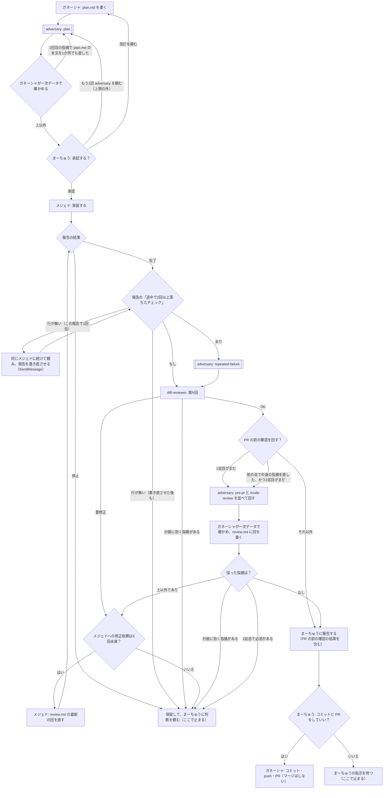

# AIチーム開発 スキル一式（下書き）

Claude Code だけで回す体制のスキル・チーム設定・権限設定。

- **ガネーシャ**（Claude Code のメイン）＝ 計画・メジェドへの実装依頼・レビュー・頼まれたときのコミットと PR・PR に付いた指摘の対応
- **メジェド**（サブエージェント `mejed`・Sonnet）＝ 実装・指摘の修正
- **adversary**（サブエージェント `adversary`・Fable）＝ 壊しに来る役。計画の承認前・チェックが2回落ちたとき・PR の前に、計画や差分を壊す側から読んで指摘だけを返す。直さない
- **まーちゅう** ＝ 要件決定・計画の承認・最終確認・マージ

> 以前は Codex をメジェドにしていたが、2つのツールの行き来（セッションの切り替え・進捗をリモートで見られない）の手間が大きかったので、
> サブエージェントだけにした（2026-10-04）。
> 当初は Codex の使用枠の消費も理由に挙げていたが、読み違いだった。5時間枠の表示の 85% は残りの量で、使ったのは 15% ほどだった（2026-10-05 に訂正。体制は変えない）。

## 中身と置き場所

`claude/` の中身を、リポジトリの `.claude/` にそのまま重ねる。

| ファイル | 担当 | 置き場所 |
| --- | --- | --- |
| `repo-files/docs/team/common-rules.md` | 共通 | リポジトリの `docs/team/common-rules.md` |
| `repo-files/docs/team/Ganesha.md` | ガネーシャ | リポジトリの `docs/team/Ganesha.md` |
| `repo-files/CLAUDE.md.snippet` | ガネーシャ | 中身を `CLAUDE.md` の先頭に追記 |
| `claude/agents/mejed.md` | メジェド | `.claude/agents/mejed.md`。キャラ・手順・報告の形式・禁止事項。モデルは Sonnet |
| `claude/agents/adversary.md` | adversary | `.claude/agents/adversary.md`。タイミングごとの問い・報告の形式・禁止事項。モデルは Fable |
| `claude/skills/plan-writer/` | ガネーシャ | `.claude/skills/plan-writer/`。承認を頼む前に adversary を呼ぶ |
| `claude/skills/delegate-to-mejed/` | ガネーシャ | `.claude/skills/delegate-to-mejed/`。メジェドに実装を頼み、レビュー→修正を最大3回回す。PR の前に adversary と `/code-review` を並べて最大2巡回す |
| `claude/skills/diff-reviewer/` | ガネーシャ | `.claude/skills/diff-reviewer/`。PR 前の差分レビューと、PR に付いた指摘の対応 |
| `claude/hooks/guard-code-edit.mjs` | 全員 | `.claude/hooks/guard-code-edit.mjs`。編集の直前に「誰が・どこを」編集するかを見て止める |
| `claude/settings.json` | 全員 | `.claude/settings.json`。フックの登録と、git・秘密情報の権限 |

## ファイルの分け方

- **CLAUDE.md**：リポジトリの説明（構成、ビルド方法、テーマ・プラグイン情報など）。先頭で `@docs/team/Ganesha.md` を取り込む
- **docs/team/common-rules.md**：共通規約とチェックコマンド。ガネーシャは取り込みで、メジェドと adversary は作業の最初に Read で読む
- **docs/team/Ganesha.md**：ガネーシャの役割・キャラ設定・禁止事項
- **.claude/agents/mejed.md**：メジェドの役割・キャラ設定・禁止事項（メジェドの定義はここだけ）
- **.claude/agents/adversary.md**：壊しに来る役の問い・報告の形式・禁止事項。キャラ設定は持たない
- **スキル**：計画・実装の依頼・レビューの手順とテンプレート
- **フック＋settings.json**：編集できる範囲と git の権限

## 編集できる範囲（フックで判定）

| 誰が | docs/tasks/ と Markdown（.md） | それ以外のコード | 秘密情報（.dev.vars、.kv/、wp-config.php、.env） | リポジトリの外 |
| --- | --- | --- | --- | --- |
| ガネーシャ | ○ | × | × | `~/.claude/projects/
/memory/`・`~/.claude/plans/`・`<一時ディレクトリ>/claude/` だけ ○ |
| メジェド（mejed） | ○ | ○ | × | 同上 |
| ほかのサブエージェント | ○ | × | × | 同上 |

- Markdown を通すのは「コード以外（.md）の PR レビューの指摘はガネーシャが直す」（Ganesha.md）ため
- adversary は tools に Edit / Write を持たないので、そもそもフックまで届かない。ファイルを書ける経路は Bash（リダイレクト・`sed -i`・`git stash` など）だけで、adversary.md の禁止事項で縛っている（Bash はフックの対象外）
- Windows のファイルシステムは大文字小文字を区別しないので、Windows ではパスを小文字にそろえてから照合する（`.DEV.VARS` も止まる）
- 判定は「指定されたパス」と「シンボリックリンク（ジャンクションを含む）をたどった実体のパス」の両方に当てる。リンク経由で秘密情報・コード・リポジトリの外を書き換えることはできない
- `~/.claude/` は丸ごと通さない。ユーザー共通の settings.json・CLAUDE.md・スキル・認証情報が入っているので、メモリと計画ファイルの2か所だけにする

- settings.json の `Edit(**/*.php)` のような禁止ルールはサブエージェントにも効いてしまい、メジェドが実装できなくなる。
  そのため編集の制限は settings.json ではなくフックで行う（フックの入力に含まれる `agent_id`／`agent_type` で呼び出し元を見分ける。メインのときは両方とも入らない）
- リポジトリの外で通すのは、Claude Code 自身の置き場所（メモリ・プランモードの計画ファイル・scratchpad）だけ
- 秘密情報のパターンは先頭で固定していないので、`.claude/worktrees/<名前>/.dev.vars` のような入れ子でも止まる

## git の権限（settings.json）

| 操作 | 扱い |
| --- | --- |
| `git diff` / `log` / `status` / `show` | 許可 |
| `git add` / `commit` / `push` / `switch`、`gh pr` | 確認付き（まーちゅうに頼まれたときだけガネーシャが行う） |
| `git checkout` / `merge` / `rebase` / `reset`、`gh pr merge` | 禁止 |

メジェドは git に書き込まない（mejed.md の禁止事項）。マージはまーちゅうが行う。

## 使い方

**タスクは1本ずつ回す。** 2本を同じ作業ツリーで並行すると、未コミットの変更が混ざる。

1. 計画：「<タスク名> の計画を立てて」→ ガネーシャが plan.md を書き（プランモードは使わない）、adversary に壊しに来させて直す → まーちゅうが承認欄にチェック
2. 実装：「<タスク名> をメジェドに実装してもらって」→ ガネーシャが `feature/<タスク名>` を切ってメジェドを呼び、レビュー→修正を回す。チェックが2回落ちていたら adversary に「隠しただけか」を見させる。OK になったら PR の前に adversary と `/code-review` を並べて回し、片付いたら報告してくる

細かい分かれ目と回数の上限は、下の「作業の流れ」にある。

## 作業の流れ

この節がフローチャートと回数の上限の正本。スキル（plan-writer・delegate-to-mejed・diff-reviewer）と mejed.md の文章は、この分かれ目に合わせて書いている。食い違ったら、ここに合わせてスキルを直す。

### 言葉の決まり

- **計画に効く指摘**：plan.md を変えないと直らない指摘。どこで出ても保留する（diff-reviewer の「計画への指摘」も同じ）
- **中身の指摘**：事実・判断・規則に効く指摘。**表記だけの指摘**（言い回し・引用・リンクの付け方）と分ける
- **2回以上落ちたチェック**：common-rules.md の「チェックコマンド」の箇条1つが、1回の実装・修正の作業の中で2回以上失敗したもの
- **停止**：メジェドが着手しない・続けられないと報告すること（未承認・確認事項が残っている・計画どおりに実装できない・弱めないと通せない）
- **保留**：ガネーシャが止まって、まーちゅうに判断を頼むこと。その後の進め方はまーちゅうの指示で決める

### 回数の上限

| 上限 | 数え方 | 超えたら |
| --- | --- | --- |
| 承認前の adversary は、承認を頼むたびに最大2回 | 1回目は書き終えたとき。2回目は、1回目の指摘で plan.md の本文を1か所でも直したときだけ。まーちゅうに頼まれて回す分は上限の外 | 2回目の指摘は、plan.md を直すか確認事項に移して承認を頼む。直したところは承認を頼むときに伝える |
| メジェドの報告の書き直し | 報告ごとに1回だけ。同じメジェドに続けて頼む（新しく呼ぶと前の経過を知らないため） | 保留 |
| メジェドへの修正依頼は最大3回 | 由来を問わず合算（diff-reviewer・repeated-failure・PR の前の確認） | 保留 |
| PR の前の確認は最大2巡 | 1巡 = adversary（pre-pr）と `/code-review high` を1回ずつ。2巡目は、1巡目で中身の指摘を直したときだけ | 2巡目で必須が出たら、直さずに保留 |
| repeated-failure の adversary | メジェドの完了の報告ごと。独自の上限は持たない | 修正依頼の上限で止まる（多くて4回） |

- 承認をやり直したら、上限は数え直す
- 数えた値は review.md の回の「数」に書く。セッションをまたいでも数え直せるようにするため
- diff-reviewer の「PR に付いたレビュー」は、PR レビューの回だけを数えて、3回目でも必須が残れば保留する
- 報告の「2回以上落ちたチェック：なし」はメジェドの自己申告で、真偽を確かめる手段は無い。弱めたテストは diff-reviewer の差分のレビューで見る
3. PR：「コミットして PR を出して」→ ガネーシャがコミット・push・PR 作成。マージはしない
4. PR のレビュー：「PR の指摘を見て」→ ガネーシャが検証して review.md に書き、コードの指摘はメジェドに直させ、スレッドに返信して再レビューを依頼する
5. マージ：まーちゅう

## 導入方法

1. `claude/` の中身をリポジトリの `.claude/` に重ねる（既存の `settings.json` があれば、内容を見比べて置き換える。`Edit(**/*.php)` のような Edit の禁止が残るとメジェドが実装できない）
2. `repo-files/docs/team/` をリポジトリの `docs/team/` に置き、`CLAUDE.md.snippet` の中身を `CLAUDE.md` の先頭に足す
3. `common-rules.md` の「チェックコマンド」を案件に合わせて書き換える
4. 案件に合わせて `guard-code-edit.mjs` の `SECRET_PATTERNS` を足す

## 導入後に確認すること

- **取り込みが効くか**：`/memory` を開き、Ganesha.md と common-rules.md が読み込まれているか確認する
- **フックが動くか**：ガネーシャに「inc/ の PHP を1行直して」と頼み、フックで止められるか確認する。次にメジェドに同じことを頼み、通るか確認する。ガネーシャがメモリに書けることも確かめる
- **Windows での実行**：フックは `node "$CLAUDE_PROJECT_DIR/..."` で呼んでいる。Windows でどのシェルが使われるかは公式ドキュメントに書かれていないが、Windows 11 の Claude Code（VS Code 拡張）では、この書き方のまま起動し、メインは止まり・`mejed` は通り・ほかのサブエージェント（`general-purpose`）は止まることを確かめた（2026-10-04・swx-inventory-hub）。止まらないときは `/hooks` で登録を確認し、コマンドをフルパスに書き換える
- **フックの単体確認**：フックに JSON を標準入力で渡して終了コードを見る（`CLAUDE_PROJECT_DIR` に仮のリポジトリのパスを入れる）。期待値は、メインの `src/a.js` が 2、メインの `docs/tasks/x/plan.md` が 0、`agent_type: mejed` の `src/a.js` が 0、`agent_type: mejed` の `.dev.vars` が 2、ほかのサブエージェントの `src/a.js` が 2、メインのメモリ（`~/.claude/projects/
/memory/`）が 0、リポジトリの外が 2、JSON でない入力が 2
- **Bash 経由の書き込みは止まらない**：`echo > file` や `sed -i` のようなシェル経由の書き込みは、このフックの対象外。
  **auto モードでは確認も出ない**ので、仕組みの上ではガネーシャも Bash でコードを書き換えられる。ここは Ganesha.md の禁止事項で縛っている。気づいたら止める
- **サブエージェントの権限モード**：メインが `acceptEdits` や `auto` で動いているときは、メジェドもそのモードで動く。フックは権限モードとは別の仕組みだけど、念のため `acceptEdits` でもガネーシャの編集が止まるか試す
- **秘密情報**：フックの `SECRET_PATTERNS` と settings.json の `Read(...)` の deny を、案件に応じて追加・削除する
