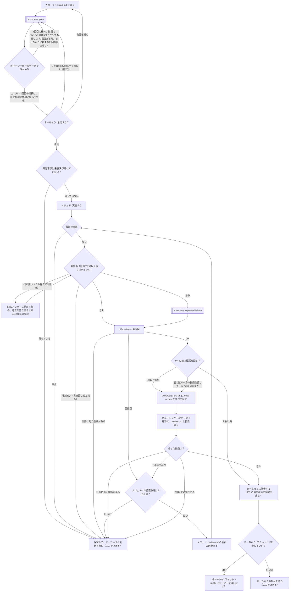

# 計画書：adversary

- 作成：ガネーシャ（2026-10-05）
- 承認：[x] まーちゅう（承認日：2026-10-05。承認依頼2の口頭の承認をガネーシャが記入）
- ブランチ：`chore/4-adversary`（リポジトリの外の worktree で作業）
- イシュー：#4（PR には `Refs #4` と書く。#4 の完了条件の「実際のタスクで1本回す」が残るため）
- 改訂履歴：
  - 2026-10-05 初版（同日に口頭で承認）
  - 2026-10-05 PR の前の確認（adversary・`/code-review`）の指摘で改訂。流れをフローチャートで1つに決め、回数の上限の数え方をそろえた。サブエージェントの事実（呼べる）と、フックの完了条件（adversary の tools に Edit / Write が無い）を直した。費用の見積もりを直した。README にフローチャートを載せる。この確認の記録として review.md を作る
  - 2026-10-05 承認前の adversary（1回目）の指摘で改訂。実装はガネーシャが行うことを明記。フローチャートに「停止」「書き直しの上限」「保留・PR を断ったときの終わり」を足した。承認前の指摘の置き場（plan のテンプレートに節を足す）を足した
  - 2026-10-05 承認前の adversary（2回目）の指摘で改訂。報告の書き直しは同じメジェドに続けて頼む（SendMessage）。PR の前の確認は採る指摘が無くても review.md に書き、計画に効く指摘なら保留する。マージ後のフローチャートの正本は README。#1 に権限の穴をコメントで足す。ローカルのパスを消した
  - 2026-10-05 承認前の adversary（3回目・まーちゅうの指示で上限の外。6つの角度と3票の検証）の指摘で、**書き足さずに削る方向で**書き直した。指摘の数が巡ごとに増えていた（9→12→15）ため。作業ツリーのパスを adversary にだけ渡す仕組みをやめた（メジェドと diff-reviewer とツリーが食い違う。worktree の流れは #1 で決める）。`/code-review` にパスを渡すのをやめ、引数は効力レベルだけにした（パスを渡すとそのパスだけを見るため）。承認をやり直した後の細かい手順を書かず、保留してまーちゅうの指示で決める形にした（同日に口頭で承認）
  - 2026-10-05 実装後の PR の前の確認（1巡目）で計画に効く指摘が2件出て保留し、まーちゅうの判断で改訂。フローチャートと回数の上限の正本を README から `docs/team/workflow.md`（新設・各リポジトリに配る）に移した（README は反映先に配られないため）。承認の後に確認事項が残っていないかを確かめ、残っていれば保留する分かれ目を足した。V1 の戻り辺に「2回目がまだ」の条件を足した。あわせて、PR の前の確認で採った指摘を計画に入れた（`/code-review` の引数を `high --max-findings default`、PR レビューの上限を修正依頼3回にそろえる、保留に理由を添える、メジェドは未承認・確認事項ありでも「結果：停止」で報告する、adversary は `??` の新規ファイルを読み・承認前の記録の節を判断に使わない、3つのスキルとメジェドが workflow.md を読む、確認事項の未解決の基準、diff-reviewer の報告の見方と手順5、README の番号リスト、review.md の「数」の単位、費用の注記）

## 目的

コードを書かずに壊しに来るだけの役（adversary）を、テンプレートに足す。
同じ計画を読んだレビュー（diff-reviewer）が同じ思い込みで読み飛ばすところを、計画を知らない目で突く。

## 決めたこと（まーちゅう・2026-10-05）

- 作り方は**案1から始める**：読むだけのサブエージェント（モデルは Fable）。Codex に任せる案2は #3 ができてから
- タイミングは**3つとも入れる**：計画の承認前／チェックが2回落ちたとき／PR の前
- PR の前の `/code-review` とは**並べる**（置き換えない）
- 流れを**フローチャートで1回きちんと書く**（下の「流れ」）。スキルの文章は、このフローチャートに合わせる
- フローチャートと回数の上限の**正本は `docs/team/workflow.md`**（テンプレートでは `repo-files/docs/team/workflow.md`）。各リポジトリに配り、スキルはそこを参照する。README には要約とリンクだけを置く（README は反映先に配られないため）
- **承認の後に、確認事項に未解決が残っていないかを確かめる。** 残っていれば、メジェドを呼ぶ前に保留してまーちゅうに聞く（確認事項が残ったまま承認されると、メジェドが着手せずに停止して1往復むだになるため）
- #4 の書き方から変えた点：「チェックが2回落ちたとき」は、落ちたその場ではなく、メジェドの報告を受けたときに見る。メジェドは2回落ちても止めずに直し続け、報告に書く（止めると毎回まーちゅうを待つことになるため）

## 背景・前提

- **このタスクの実装はガネーシャが行う。** テンプレートのリポジトリにはフックもメジェドも入っておらず、変えるのは Markdown だけのため。review.md もガネーシャが書く記録
  - このタスクで通るのは、計画（P1〜U1・Q1）と、ガネーシャ自身のレビュー（D1）から PR の前の確認（C1・X・W・V3）まで。採った指摘はガネーシャが直して D1 に戻る。メジェドの報告の分かれ目（S1・R1・RW・A2）と修正依頼の回数（L1）は通らない
  - このタスクの PR の前の確認では、改訂前の計画で実装したもの（a4c43b0・5f3c11c）がコミット済みなので、差分は `origin/main...HEAD` と未コミットの分を合わせて見るよう adversary に伝える。共通規約は `repo-files/docs/team/common-rules.md`、作業の流れは `repo-files/docs/team/workflow.md` にあることも伝える（このリポジトリはテンプレート置き場で、`docs/team/` もスキルも入っていない）
- **このセッションで回した adversary は、定義どおりのエージェントではない。** 定義（`claude/agents/adversary.md`）はまだどのリポジトリの `.claude/agents/` にも入っていないので、汎用のエージェントに Fable を指定し、定義を読ませて回した。tools の制限（Edit / Write なし）はかかっていなかった。定義どおりに動くかは、反映先で確かめる（#4 の完了条件の2つ目）
- 2026-10-04 に、diff-reviewer の判定 OK の後で `/code-review` を回すと、指摘がまとまって出た
- テンプレートの delegate-to-mejed には、まだ `/code-review` の段が無い。hub では rocket-martue/swx-inventory-hub#92 の3で足す予定だったが未着手。「並べる」ために、この計画で `/code-review` の段も入れる。#92 の3は、テンプレートを hub に反映するときに満たす（hub はテンプレートより先に進んでいるところがあり、hub 固有の書き換えとは手で混ぜる）
- サブエージェントは、既定でメインから3階層下までサブエージェントを呼べる（公式ドキュメント sub-agents）。それでも、2つ目のタイミングの adversary はガネーシャが呼ぶ。メジェドの tools に Agent が無いことと、指摘を確かめるのはガネーシャの役目だから
- エージェント定義の `model` には、別名として `fable` を書ける（公式ドキュメント sub-agents）
- adversary の tools は Read・Grep・Glob・Bash で、**Edit / Write が無い。** だからフックには届かない。ファイルを書ける経路は Bash だけで、定義の禁止事項で縛る（ほかの役の Bash と同じ）
- `/code-review` は、引数で対象を渡さなければ「ブランチのコミット（上流より先の分）と未コミットの変更」を見る。対象（パス・PR・ブランチ）を渡すと、それだけを見る。効力レベルと `--max-findings` は、渡さないと前に打った値（別のセッションを含む）を引き継ぐ。`--max-findings` は `default` を渡すと既定に戻る（公式ドキュメント code-review）。未追跡の新規ファイルが「未コミットの変更」に入るかは確かめていない（入らなくても adversary は `git status --short` で見る）
- 次のことは、この計画では直さず、#1 にコメントで足す
  - Bash の権限の穴：`git stash`・`git restore`・`git clean` が settings.json の ask にも deny にも無い
  - `git -C <パス> ...` は、settings.json の allow にも deny（`git reset` など）にも ask（`git add` など）にも当たらない
  - worktree で作業するとき、メジェド・diff-reviewer・adversary がどのツリーを読み書きするか（外部 worktree の件とまとめて決める）
  - ユーザー共通の gh-review スキルと diff-reviewer の「PR に付いたレビュー」が、同じ依頼文で発火しうる（上限と記録の有無が変わる）
  - hub のスキルはテンプレートより先に進んでいるところがあり、テンプレートを正本として重ねると hub の改善が消える

## 流れ

### 言葉の決まり

- **計画に効く指摘**：plan.md を変えないと直らない指摘。どこで出ても、保留して、まーちゅうに判断を頼む（diff-reviewer の「計画への指摘」も同じ）
- **中身の指摘**：事実・判断・規則に効く指摘。**表記だけの指摘**（言い回し・引用・リンクの付け方）と分ける
- **2回以上落ちたチェック**：common-rules.md の「チェックコマンド」の箇条1つが、1回の実装・修正の作業の中で2回以上失敗したもの
- **停止**：メジェドが着手しない・続けられないと報告すること（未承認・確認事項が残っている・計画どおりに実装できない・弱めないと通せない）。**保留**：ガネーシャが止まって、まーちゅうに判断を頼むこと。理由（メジェドの停止の理由・達した上限・該当する指摘）を添える
- **確認事項の未解決**：plan.md の「確認事項」の項目のうち、まーちゅうの答えが「→」に続けて書き足されていないもの（例: 「→ OK（2026-10-04 まーちゅう）」）。節が「なし」だけなら未解決は無い。ガネーシャの Q1 とメジェドの手順2は、同じこの基準で判定する

### 回数の上限（フローチャートの分かれ目と同じ）

| 上限 | 数え方 | 超えたら |
| --- | --- | --- |
| 承認前の adversary は、承認を頼むたびに最大2回 | 1回目は書き終えたとき。2回目は、1回目の指摘で plan.md の本文を1か所でも直したときだけ。まーちゅうに頼まれて回す分は上限の外 | 2回目の指摘は、plan.md を直すか確認事項に移して承認を頼む。直したところは承認を頼むときに伝える |
| メジェドの報告の書き直し | 報告ごとに1回だけ。同じメジェドに続けて頼む（新しく呼ぶと前の経過を知らないため） | 保留 |
| メジェドへの修正依頼は最大3回 | 由来を問わず合算（diff-reviewer・repeated-failure・PR の前の確認） | 保留 |
| PR の前の確認は最大2巡 | 1巡 = adversary（pre-pr）と `/code-review` を1回ずつ。2巡目は、1巡目で中身の指摘を直したときだけ | 2巡目で必須が出たら、直さずに保留 |
| repeated-failure の adversary | メジェドの完了の報告ごと。独自の上限は持たない | 修正依頼の上限で止まる（PR の前までで多くて4回） |

- 保留の後の進め方（計画の改訂・修正の追加など）は、まーちゅうの指示で決める。承認をやり直したら、上限は数え直す
- 数えた値は review.md の回に書く（出所・修正依頼の何回目か・PR の前の確認の何巡目か）。セッションをまたいでも数え直せるようにするため
- diff-reviewer の「第3回でも必須が残れば保留」は、`delegate-to-mejed` の途中では使わず、上の上限に従う。PR に付いたレビューを受けるときは、PR レビューでのメジェドへの修正依頼を数えて、最大3回（3回直しても必須が残れば保留）。PR の前の上限とそろえる
- R1 の「なし」はメジェドの自己申告で、ガネーシャには真偽を確かめる手段が無い。弱めたテストは diff-reviewer の差分のレビューで見る（案1の限界として承知のうえで入れる）

## 対象ファイル

| パス | 種別 | 変更の概要 |
| --- | --- | --- |
| `claude/agents/adversary.md` | 新規 | 壊しに来る役の定義（下の「adversary.md の中身」） |
| `claude/skills/plan-writer/SKILL.md` | 変更 | 承認を頼む前に adversary を呼ぶ段。承認依頼ごとに最大2回（まーちゅうに頼まれた分は上限の外）。結果を plan.md の「承認前の adversary」の節に書く。冒頭に「最初に `docs/team/workflow.md` を Read で読む」 |
| `claude/skills/plan-writer/templates/plan.md` | 変更 | 「承認前の adversary」の節（承認依頼ごとに、採った・確認事項に移した・見送った指摘と理由） |
| `repo-files/docs/team/workflow.md` | 新規 | 上の「流れ」「言葉の決まり」「回数の上限」の正本。各リポジトリの `docs/team/workflow.md` に配る |
| `claude/skills/delegate-to-mejed/SKILL.md` | 変更 | 冒頭に「最初に `docs/team/workflow.md` を Read で読む」。手順1で、承認欄に加えて確認事項に未解決が無いかを見る（残っていれば保留）。報告の結果と「2回以上落ちたチェック」を見る段（停止は保留、行が無ければ報告ごとに1回だけ同じメジェドに書き直させる）。PR の前の確認の段（adversary と `/code-review` を並べる。`/code-review` の引数は `high --max-findings default`）。回数の上限と、保留の後はまーちゅうの指示で決めること |
| `claude/agents/mejed.md` | 変更 | 報告の形式に「途中で2回以上落ちたチェックと、通すために変えたこと」（実装・修正の両方。粒度は上の「言葉の決まり」）。禁止事項に「plan.md に無いのにチェックやテストを弱めて通すこと」。未承認・確認事項ありのときも「結果：停止」として報告する。「最初に必ず読むこと」に `docs/team/workflow.md` を足し、手順2の確認事項の未解決は workflow.md の基準で判定する |
| `claude/skills/diff-reviewer/SKILL.md` | 変更 | adversary と `/code-review` の指摘の受け方（一次データで確かめる・出所・見送り）。計画に効く指摘は保留。上限は delegate-to-mejed に従い、PR に付いたレビューは PR レビューでの修正依頼を最大3回と数える。冒頭に「最初に `docs/team/workflow.md` を Read で読む」を書く。PR レビューの修正をメジェドに頼んだときの報告の見方は、要約せず「delegate-to-mejed の『メジェドの報告の受け方』の手順どおりに見る」とだけ書く。手順5「判定を出して、まーちゅうに結果を伝えて止まる」は、delegate-to-mejed の途中なら判定を返して続ける（止まらない）、単独で頼まれたときだけ伝えて止まる、に直す |
| `claude/skills/diff-reviewer/templates/review.md` | 変更 | 回の見出しの下に「出所」（例: adversary・pre-pr・1巡目）と「数」（修正依頼の何回目か・PR の前の確認の何巡目か・PR レビューでの修正依頼の何回目か）の行、「見送った指摘」の節 |
| `repo-files/docs/team/common-rules.md` | 変更 | 冒頭の「従う人」に adversary を足す。チームの表に adversary の行 |
| `repo-files/docs/team/Ganesha.md` | 変更 | 役割に「adversary を呼び、指摘を確かめる」 |
| `README.md` | 変更 | 作業の流れの要約と、正本（`repo-files/docs/team/workflow.md`）へのリンク。要約の節は「使い方」の番号リスト（1〜5）の後ろに置き、リストを割らない。中身と置き場所の表（workflow.md の行を足す）、ファイルの分け方、導入方法、編集できる範囲（adversary は Edit / Write を持たず、書ける経路は Bash だけ）、使い方の流れ |
| `docs/tasks/adversary/review.md` | 新規 | ガネーシャが書く記録。フローチャートの分かれ目とスキルの文の突き合わせ。PR の前の確認の指摘と、採った・見送った判断 |

## 変更内容

### adversary.md の中身

- frontmatter：`name: adversary`、`model: fable`、`tools: Read, Grep, Glob, Bash`
- 役割：計画・差分を壊す側から読む。**直さない・コードを書かない・指摘だけ**
- 受け取るもの（ガネーシャが渡す。ガネーシャ自身の結論や見立ては渡さない。先入観を移さないため）
  - タイミングの名前（plan／repeated-failure／pre-pr）
  - タスク名と plan.md のパス
  - repeated-failure・pre-pr は差分の取り方（`git diff HEAD` と `git status --short`。`??` の新規ファイルは Read で中身を読む）
  - plan.md の「承認前の adversary」の節は読まない（ガネーシャの採否の判断が入っているため。Read で全文を開いたときも、その節の中身は判断に使わない）
  - repeated-failure は、メジェドの報告の「途中で2回以上落ちたチェック」の行
- タイミングごとの問い
  - plan：外との約束（ほかのリポジトリ・API・データの形）が両側で合っているか。完了条件は第三者が Yes／No で判定できるか。対象外にしたことが、実は対象に要らないか
  - repeated-failure：落ちていたチェックは本当に直ったのか、隠しただけか（テストを弱めた・条件を外した・例外を握り潰した・期待値を書き換えた）
  - pre-pr：何がこれを壊すか（境界値・空・重複・並行・古いデータ・権限・秘密情報）
- 最初に `docs/team/common-rules.md` と plan.md を Read で読む
- 報告の形式：指摘ごとに「重要度（必須／推奨）」「場所」「壊れ方」「根拠」。見つからなければ「なし」。確かめられなかったものは根拠に「推測」と書く
- 絶対にしないこと：ファイルの編集・作成（Bash 経由も。plan.md・review.md も含む）、コミット・ブランチ操作・`git stash` など作業ツリーを変えるコマンド、秘密情報のファイルを読むこと

### タイミング1：計画の承認前（plan-writer）

- plan.md を書き終えて承認を頼む前に、adversary を呼ぶ（タイミングの名前・タスク名・plan.md のパスを渡す）。改訂して再承認を頼む前も同じ
- 指摘は一次データで確かめる。本当のものは plan.md の本文を直して改訂履歴に書くか、確認事項に移す
- 結果は plan.md の「承認前の adversary」の節に、承認依頼ごとに書く。承認を頼むときも、まーちゅうに同じことを伝える
- 回数は上の表のとおり

### タイミング2：チェックが2回落ちたとき（delegate-to-mejed・mejed.md・diff-reviewer）

- メジェドは今までどおり、チェックが全部通るまで直す。2回落ちても止めない（弱めないと通せないと分かったら停止）
- 報告に「途中で2回以上落ちたチェックと、通すために変えたこと」を書く。無ければ「なし」。実装と修正のどちらの報告にも書く
- ガネーシャは、メジェドの報告を受けるたびに（PR レビューの修正のときも）、結果と行を見る。停止なら保留。行が無ければ1回だけ同じメジェドに書き直させる。「なし」でなければ、次の diff-reviewer の前に adversary を repeated-failure で呼び、指摘をその回に出所付きで入れる
- 禁止事項の「チェックやテストを弱める」は、plan.md に書かれていないものに限る

### タイミング3：PR の前（delegate-to-mejed）

- diff-reviewer の判定が OK になったら、フローチャートの「PR の前の確認を回す？」で決める
- 回すときは、adversary（pre-pr）と `/code-review` を並べて回す。`/code-review` は Skill ツールで、引数は `high --max-findings default` にする（対象は既定のまま。対象を渡すとそれだけを見る）
- 指摘は1件ずつ一次データで確かめ、採る指摘が無くても review.md に回を書く。計画に効く指摘・2巡目の必須は保留。それ以外はメジェドに直させて diff-reviewer に戻る
- まーちゅうへの報告に、両方の結果を入れる

### データの流れ

なし（スキル・エージェント定義・チーム文書だけ）。

## 方針

- 費用：1タスク（承認依頼1回）で、Fable は多くて8回（承認前2・repeated-failure 4・PR の前2。PR に付いたレビューの段は別）。ふつうは2〜3回。`/code-review` は最大2回。まーちゅうに頼まれて回す分は別
- 指摘を確かめるのはガネーシャ。adversary の指摘をそのまま直させない
- スキルの文章とフローチャートが食い違ったら、フローチャートに合わせて文章を直す。マージ後の正本は `docs/team/workflow.md`（テンプレートでは `repo-files/docs/team/workflow.md`）
- 指摘の数が巡ごとに減らないときは、書き足さずに削る

## 必須パターン

なし

## 対象外（やらないこと）

- 案2（Codex に壊しに来させる）。#3 ができてから選べるようにする
- 4リポジトリ（hub・site・チャンネル・ボイススタジオ）への反映。#1 の反映と一緒に行う
- 実際のタスクで1本回して確かめること（#4 の完了条件の2つ目）。反映した先で行う
- worktree で作業するときのツリーの扱い、フックの範囲、Bash の権限の穴、allow・deny・ask の当たり方を直すこと（#1。コメントで足すだけ）
- 承認欄を誰が埋めるか（hub #92）

## 完了条件

- [ ] `claude/agents/adversary.md` があり、frontmatter が `model: fable`・tools が Read・Grep・Glob・Bash（Edit / Write が無い）で、上の「adversary.md の中身」がすべて入っている
- [ ] `repo-files/docs/team/workflow.md` に上の「流れ」「言葉の決まり」「回数の上限」があり、plan-writer・delegate-to-mejed・diff-reviewer・mejed.md の文章が、フローチャートの分かれ目とすべて一致している。スキルは `docs/team/workflow.md` を参照している
- [ ] README の「中身と置き場所」の表に workflow.md の行があり、導入方法の手順に「`docs/team/` に workflow.md も入る」と書いてある。README の作業の流れは要約と workflow.md へのリンクだけになっている
- [ ] plan-writer・delegate-to-mejed・diff-reviewer の冒頭に「最初に `docs/team/workflow.md` を Read で読む」がある
- [ ] workflow.md の「言葉の決まり」に確認事項の未解決の基準があり、delegate-to-mejed の手順1と mejed.md の手順2が同じ基準を指している
- [ ] delegate-to-mejed の手順1で、確認事項に未解決が残っていれば保留する
- [ ] delegate-to-mejed に、停止は保留・行が無いときは報告ごとに1回だけ同じメジェドに書き直させる・PR の前の確認（adversary と `/code-review high --max-findings default` を並べる・採る指摘が無くても review.md に書く・計画に効く指摘と2巡目の必須は保留）・保留の後はまーちゅうの指示で決める、が書いてある
- [ ] plan-writer に承認前の adversary（最大2回・まーちゅうに頼まれた分は上限の外）があり、templates/plan.md に承認依頼ごとの「承認前の adversary」の節がある
- [ ] diff-reviewer に、出所の書き方・計画に効く指摘は保留・PR に付いたレビューは PR レビューでの修正依頼を最大3回と数える、が書いてある。PR レビューの修正の報告の見方が「delegate-to-mejed の『メジェドの報告の受け方』の手順どおり」の1文になっていて、要約の文が無い。手順5が「delegate-to-mejed の途中なら判定を返して続ける、単独で頼まれたときだけ伝えて止まる」になっている
- [ ] mejed.md の「最初に必ず読むこと」に `docs/team/workflow.md` がある
- [ ] README の「使い方」の番号リスト（1〜5）が途中で割れていない
- [ ] mejed.md の報告の形式に「途中で2回以上落ちたチェック」の行があり（実装・修正の両方、粒度つき）、禁止事項の「チェックやテストを弱める」が plan.md に無いものに限られている
- [ ] review.md のテンプレートに「出所」「数」の行と「見送った指摘」の節があり、「数」の PR レビューの単位が「修正依頼の何回目」になっている
- [ ] README・common-rules.md・Ganesha.md のチームの説明に adversary が出てくる。README の編集できる範囲の説明が「adversary は Edit / Write を持たず、書ける経路は Bash だけ」になっている
- [ ] `docs/tasks/adversary/review.md` に、フローチャートの分かれ目ごとに、該当するスキルの文（ファイル:行）を指した突き合わせの表がある
- [ ] #1 に、上の「次のことは、この計画では直さず、#1 にコメントで足す」の5つをコメントで足した

## テスト観点

- フローチャートの分かれ目ごとに、該当するスキルの文を1つずつ指して突き合わせる（review.md に表で残す）
- PR を出した後に、GitHub の PR の画面でフローチャートが図として描画されることを確かめる（push の前にはできない）
- 反映先のリポジトリで実際に回す確認は、対象外（#4 の完了条件の2つ目）

## 承認前の adversary

### 承認依頼1・1回目（2026-10-05・改訂後の plan.md に対して）

- 採った（plan.md を直した）
  - 必須: 作業ツリーのパスが plan-writer・delegate-to-mejed の変更内容に無かった／review.md を対象ファイルに置くとメジェドの禁止事項とぶつかる（実装はガネーシャと明記）／フローチャートに「停止」の出口が無く、書き直しの往復に上限が無かった
  - 推奨: 確認事項に移しただけのときの扱い／U2 の「いいえ」と保留の先／repeated-failure の上限の言い方／PR レビューの上限の数え方／この作業ツリーでの差分の基点／承認前の指摘の置き場
- 言い方を変えて採った
  - `/code-review` が未追跡ファイルを見るかの根拠が無い → 「確かめられていない」と書き、1回の呼び出しにパスを書いて渡す形にした（3回目でやめた）
- 見送った
  - mermaid が GitHub で描画できるか → テスト観点（PR の後に確かめる）で扱う
  - サブエージェントが3階層下まで呼べるか → ガネーシャが公式ドキュメント（sub-agents）で確かめ済み
  - 報告の「`model: fable` の frontmatter で自分が動いていることを確かめた」は誤り。ガネーシャが呼び出しでモデルを指定しており、frontmatter を通っていない

### 承認依頼1・2回目（2026-10-05・1回目の指摘で直した後）

- 採った（plan.md を直した）
  - 必須: 完了条件の「PR の前の確認の記録」は diff-reviewer の時点では存在しない → 完了条件から外した／報告の書き直しを新しいメジェドに頼むと前の経過を知らない → 同じメジェドに SendMessage で続けて頼む／対象外の「#92 以上の変更をしない」が食い違う → 外した
  - 推奨: 計画に効く指摘が PR の前の確認で出たら保留する道／採る指摘が無い巡も review.md に書く／このタスクで通る分かれ目／`git -C` が allow に当たらない（#1 へ）／#1 へのコメントを完了条件に入れた／GitHub での描画の確認は PR の後／分かれ目と書き直しの数え方の言い方／マージ後の正本は README
- まーちゅうに伝えたこと：R1 の「なし」はメジェドの自己申告で、真偽を確かめる手段が無い（案1の限界）

### 承認依頼1・3回目（2026-10-05・まーちゅうの指示で上限の外。6つの角度の Fable と、指摘ごとに3票の検証）

- 数：指摘45件 → まとめて30件 → 検証を通った15件（退けた15件）。最後の見落とし探しで、さらに7つの角度で壊れ方が見つかった
- **書き足さずに削った**（巡ごとに指摘が増えていたため）
  - 作業ツリーのパスを adversary にだけ渡す仕組み（メジェド・diff-reviewer とツリーが食い違う。worktree の扱いは #1 へ）
  - `/code-review` にパスを渡すこと（渡すとそのパスだけを見る。公式ドキュメント code-review）→ 引数は効力レベル `high` だけ
  - 承認をやり直した後の細かい手順（再入口・数え直しの段取り）→ 保留して、まーちゅうの指示で決める
- 採った（小さく直した）
  - まーちゅうに頼まれた adversary は上限の外（U1 に出口を足した）／diff-reviewer の「計画への指摘」で保留する出口／「計画に効く指摘」「中身の指摘」「停止」「保留」の言葉の決まり／「2回以上落ちたチェック」の粒度／`/code-review` の効力レベルを毎回渡す／PR レビューの修正でも報告の行を見る／review.md に出所のタイミング・巡と、数えた値を書く／承認前の記録を承認依頼ごとに分ける／PR は `Refs #4`／#4 の書き方から変えた点を「決めたこと」に書いた／このセッションの adversary は定義どおりのエージェントではないことを書いた
  - #1 へ回す：`git -C` が deny・ask にも当たらない／gh-review と diff-reviewer の発火の重なり／hub がテンプレートより先に進んでいる／worktree のときのツリーの扱い
- 退けた指摘（3票のうち本当が1票以下）は15件。主なもの：メジェドの停止の報告を S1 で判定できない（手順どおり停止と書くので判定できる）／V1 の出口が排他でない／README に表の下の規則が入らない（README に載せる対象に入れた）など

### 承認依頼2・1回目（2026-10-05・PR の前の確認で保留し、正本の場所と確認事項の扱いを改訂した後）

- 採った（plan.md を直した）
  - 必須: PR の前の確認で採った `--max-findings default` が計画に入っていなかった／PR レビューの上限（修正依頼を最大3回にそろえる）と保留の理由が計画に入っていなかった
  - 推奨: どのスキルが workflow.md をどう読むか（3つのスキルの冒頭で Read）／確認事項の「未解決」の基準（「→ 答え：」の有無。Q1 とメジェドの手順2で同じ基準）／このタスクで通る分かれ目に Q1 と2コミットを反映／README の導入方法に workflow.md が配られることを書く
- adversary から「Read で全文を開いたので、承認前の記録の節も目に入った（判断には使っていない）」と申告があった → adversary.md の書き方を「その節の中身は判断に使わない」まで強めた

### 承認依頼2・2回目（2026-10-05・1回目の指摘で直した後。この承認依頼の上限）

- 採った（plan.md を直した。2回目の後に直したので、承認を頼むときに伝える）
  - 必須: `/code-review` の引数が対象ファイルの行だけ `high` のままだった／「→ 答え：」の基準では「なし」だけの計画や、hub の「→ OK（日付 まーちゅう）」の書き方まで未解決になる → 「→」に続く答えの有無、「なし」だけなら未解決なし、にした／PR の前の確認で採った必須 #3・#4（diff-reviewer の報告の見方の要約・手順5）が計画に無かった → 対象ファイルと完了条件に入れた
  - 推奨: メジェドも workflow.md を読む／README の要約の節は「使い方」の番号リストの後ろに置く／改訂履歴を書き足した／review.md の「数」の PR レビューの単位を修正依頼に／このリポジトリ自身には `docs/team/` が無いので workflow.md の場所も伝える／まーちゅうに頼まれた回の後は V1 から A1 に戻らない

## 確認事項

- なし
