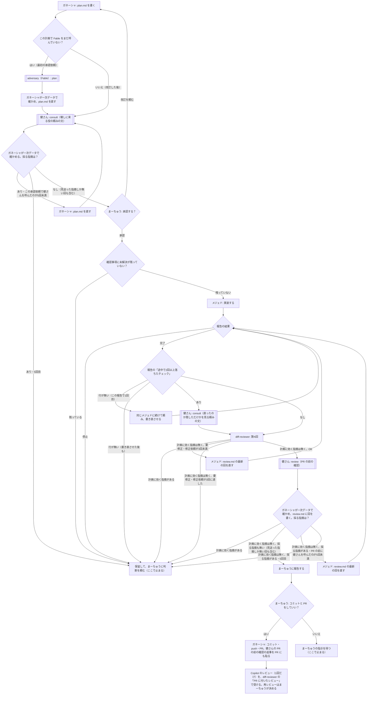

# 計画書：workflow-redesign

- 作成：ガネーシャ（2026-10-06）
- 承認：[x] まーちゅう（承認日：2026-10-06。会話で「OK進めて」）
- ブランチ：`chore/3-workflow-redesign`（リポジトリの外の worktree で作業）
- イシュー：#3（後半の「設計の見直し」）・#5（PR #6 で残した8件）。PR には `Closes #5`・`Refs #3` と書く（#3 は、4リポジトリへの反映と実際のタスクでの確認が残るため）
- 改訂履歴：
  - 2026-10-06 初版
  - 2026-10-06 承認前の確認（Fable・1回）の指摘で改訂。上限の分岐を排他にし、健さんの上限は呼んだ回数で数える。対象ファイルの説明から数字を消した。mejed.md を対象に足した。Fable は1つの計画につき1回で、指摘を確かめて直してから健さんに回す。K3 に review.md が渡る限界を書いた。K2 の未追跡の見方、確認事項の署名の基準、Copilot の再レビュー、PR に貼る返事の範囲を足した
  - 2026-10-06 健さん1回目の指摘で改訂。PR の前の分岐で計画に効く指摘を先に判定する。確認事項は最上位の箇条ごとに判定する。plan-writer の禁止事項に scratchpad の例外を足す。健さんの指摘で採ったものは必須として書く。健さんを呼べなかったときは保留。Fable は数え直さない。比較表の健さんの上限を呼んだ回数に揃えた
  - 2026-10-06 健さん2回目の指摘で改訂。「→ 後で決める」は署名があっても未解決。common-rules の健さんの決まり（頼みの文）を review に合わせて直す対象に足した。plan-writer の変更の概要から回数を消した。D1 の分岐を排他にした。「決めたこと」を「採る指摘が0」に揃えた
  - 2026-10-06 健さん3回目の指摘で改訂。確認事項で解決扱いにするのは本文がちょうど「なし」の項目だけにした。スキルの変更の概要から「Copilot は1回だけ」を消した。README の「使い方」を対象に足した
  - 2026-10-06 健さん4回目の指摘で改訂。書き直させた報告も S1 で停止を判定する。数えた値の書き先を、承認前は plan.md・実装の後は review.md に分けた

## 目的

作業の流れ（`workflow.md`）を、健さん（Codex）を中心に組み直して簡単にする。Fable の使用量を減らし、PR の前の確認を「健さんに採る指摘が0になるまで頼む」形にする。#5 の8件は、この中で直すか、規則ごと要らなくする。

## 決めたこと（まーちゅう・2026-10-06）

- PR の前の確認は**健さんの review だけ**にする。`/code-review` は外す（まーちゅうに頼まれたときだけ回す）
- 健さんには、計画の承認前・PR の前それぞれで**採る指摘が0になるまで頼み、5回で保留**する（見送った指摘しか無い回も、0として止める）
- Copilot のレビューは **PR で1回だけ**。健さんで採る指摘が0になってから PR を出し、Copilot は最後の別の目として見てもらう。直した後に Copilot へ再レビューを頼むかは、まーちゅうが決める
- （#3 の見直しの方向・2026-10-05）Fable（adversary）は**1つの計画につき1回だけ**（最初の承認依頼の前）。改訂して承認をやり直すときは健さんだけ。実装の後の確認（チェックが2回以上落ちたとき・PR の前）も健さん

## 背景・前提

- タスクA（PR #7）で、計画を Fable 1回・健さん5回、PR の前の確認を健さん3回見てもらい、どちらも指摘が0になって止まった（指摘は計画 10→7→6→5→4→0、PR の前 2→2→0）。直すときに書き足すより作りを替えて削ったところで収束した
- 健さんの枠：計画のレビュー1回でおよそ5%、`consult` や短い差分の `review` はもっと軽い（Codex の5時間枠）。Fable は #4 で使いすぎて使用量の上限に当たった
- 今の `workflow.md`（PR #6）は、adversary（Fable）を3つのタイミングで呼び、PR の前は adversary と `/code-review` を並べて最大2巡、2巡目の条件（中身の指摘か表記だけか）など、分かれ目と上限が多い。#4 では規則を足すたびに指摘が増えた
- 健さんの `review`（`codex exec review`）は頼みの文を受け付けない（対象の指定と排他）。adversary の役（問いを渡して壊しに来させる）を頼むときは `consult` に頼みの文を付けて呼ぶ（タスクA の計画のレビューと同じ形）
- このタスクの実装はガネーシャが行う（テンプレートのリポジトリにはフックもメジェドも無く、変えるのは Markdown だけ）

## 新しい流れ

- 「ここで止まる」の先は、まーちゅうの指示で決める。承認をやり直したら、回数は数え直す（Fable は数え直さない。1つの計画につき1回のまま）
- 健さん（K1・K2・K3）を呼べなかったとき（ラッパーが止まった・返事が取れなかった）は、「採る指摘が無い」とは扱わず、H（保留）に進む
- 健さんの指摘で採ったものは、健さんの付けた重要度にかかわらず、review.md（承認前は plan.md の「承認前の確認」）に**必須**として書く。採らないものは見送りとして理由を書く（メジェドが推奨として見送れないようにするため）
- M3（健さんの指摘を直した後）は、S1・R1・D1 を通って K3 に戻る。diff-reviewer のレビューを挟むのは、直したところを計画と照らすため。このとき D1 が出す要修正は、diff-reviewer の修正依頼（最大3回）として数える
- 健さんの上限（承認前・PR の前それぞれ5回）は、**健さんを呼んだ回数**で数える（指摘の数や修正依頼の数ではない）
- K3（健さんの review）には、頼みの文を渡せないので、未コミットの `docs/tasks/<タスク名>/review.md`（ガネーシャの判定と採否）も差分として渡る。K1・K2（consult）では「承認前の確認」の節や review.md を判断に使わないよう頼めるが、K3 では頼めない。健さんの review は実装の差分を見る組み込みのレビューで、採否の先入観の影響は小さいと見て、限界として承知する

### 今の流れから変わるところ

| 今（PR #6） | 新しい流れ |
| --- | --- |
| 承認前：adversary（Fable）を最大2回 | Fable は1回だけ。その後は健さんに採る指摘が0になるまで（最大5回） |
| チェックが2回以上落ちたとき：adversary（Fable） | 健さん（consult） |
| PR の前：adversary（Fable）と `/code-review` を並べて最大2巡。2巡目は中身の指摘を直したときだけ・2巡目の必須は保留 | 健さんの review だけ。採る指摘が0になるまで（最大5回）。「中身の指摘か表記だけか」の区別をやめる |
| メジェドへの修正依頼は由来を問わず合算で最大3回 | diff-reviewer の指摘による修正依頼は最大3回。PR の前の健さんは呼んだ回数で最大5回（直せるのは4回目の指摘まで）。それぞれの回数で数える |
| PR を出した後の Copilot：決まりなし | 1回だけ。再レビューはまーちゅうが決める |

## 回数の上限（新しい表）

| 上限 | 数え方 | 超えたら |
| --- | --- | --- |
| 承認前の Fable | 1つの計画につき1回（最初の承認依頼の前） | — |
| 承認前の健さん | 承認を頼むたびに、健さんを呼んだ回数で最大5回。採る指摘が0になったら止める（見送った指摘しか無い回も止める） | 5回目でも採る指摘があれば保留 |
| メジェドの報告の書き直し | 報告ごとに1回だけ。同じメジェドに続けて頼む | 保留 |
| diff-reviewer の指摘による修正依頼 | 最大3回（健さんの指摘を直した後の D1 の要修正も、ここで数える） | 保留 |
| PR の前の健さん | 健さんを呼んだ回数で最大5回。採る指摘が0になったら止める（見送った指摘しか無い回も止める） | 5回目でも採る指摘があれば保留 |
| チェックが2回以上落ちたときの健さん | メジェドの完了の報告ごと。独自の上限は持たない | 修正の上限で止まる |
| PR に付いたレビュー（Copilot・人）による修正依頼 | 最大3回 | 保留 |

- まーちゅうに頼まれて回す分（「もう1回健さんに」など）は上限の外
- 数えた値は、承認前の分は plan.md の「承認前の確認」に、実装の後の分は review.md の回の「数」に書く（どちらも承認依頼の番号を書く）
- 上の数字は workflow.md にだけ書く。スキルと mejed.md には写さず、workflow.md の表を指す（#5 の2）

## 対象ファイル

| パス | 種別 | 変更の概要 |
| --- | --- | --- |
| `repo-files/docs/team/workflow.md` | 変更 | 上の「新しい流れ」「回数の上限」に書き直す。言葉の決まりから「中身の指摘／表記だけの指摘」を外し、#5 の1・5・7 を直す |
| `claude/skills/plan-writer/SKILL.md` | 変更 | 「絶対にしないこと」の「`docs/tasks/` 以外のファイルの作成・編集」に、健さんへの頼みの文を scratchpad に書くのを除く、を足す。承認前は、Fable の指摘を確かめて直してから、健さんに採る指摘が0になるまで頼む（上限は workflow.md）。健さんへの頼み方は codex スキルの「壊しに来る役を頼むとき」。数字と定義は写さない |
| `claude/skills/plan-writer/templates/plan.md` | 変更 | 「承認前の adversary」の節を「承認前の確認」にし、Fable と健さんの回を書けるようにする |
| `claude/skills/delegate-to-mejed/SKILL.md` | 変更 | チェックが2回以上落ちたときは健さん（consult）、PR の前の確認は健さんの review だけ（上限は workflow.md）。`/code-review` の段と「回すかどうか」の条件を消す。PR を出したら、PR の前の確認の健さんの返事を全部の回の分、パスの部分だけ相対パスに直して PR に貼る。Copilot のレビューの回数は workflow.md を指す。数字と定義は写さない |
| `claude/skills/diff-reviewer/SKILL.md` | 変更 | 出所の書き方（`健さん・review・N回目` など）、`/code-review` の記述を「頼まれたときだけ」にする。PR に付いたレビューの手順6の「再レビューを依頼し」を「再レビューを頼むかはまーちゅうが決める」にする。上限は workflow.md を指し、数字は写さない |
| `claude/skills/diff-reviewer/templates/review.md` | 変更 | 出所・数の例を新しい流れに合わせる（承認依頼の番号を足す。#5 の4） |
| `claude/agents/adversary.md` | 変更 | 計画の承認前（plan）だけの役にする。repeated-failure・pre-pr の問いと受け取るものを消す。読まない節の名前を「承認前の確認」に直す。Codex を呼ばない、の禁止は残す |
| `claude/agents/mejed.md` | 変更 | 「2回以上落ちたチェック」と停止の条件の定義の写しを消し、workflow.md を指す。「最初に必ず読むこと」に「読めなければ、作業を始めずに『結果：停止』で報告する」を足す（#5 の2・3） |
| `claude/skills/codex/SKILL.md` | 変更 | 「壊しに来る役を頼むとき」（計画のレビュー・直ったのか隠しただけか）の頼みの文の決まりを足す（「adversary はこのスキルを使わない」は、adversary が Fable のまま計画だけを見るので、そのまま残す） |
| `repo-files/docs/team/common-rules.md` | 変更 | チームの表の adversary と健さんの役割を、新しい流れに合わせる。「健さんに頼むときの決まり」の「頼みの文に…必ず入れる」に、`review` は頼みの文を渡せないので決まりを健さんの AGENTS.md で持たせる、を足す。「adversary と `/code-review` の指摘も」の段を、Fable と健さんの指摘に直す |
| `repo-files/docs/team/Ganesha.md` | 変更 | 壊しに来る役の呼び出しの行を、新しい流れに合わせる |
| `README.md` | 変更 | 作業の流れの要約、チームの説明、中身と置き場所の表、「使い方」の手順（1 の adversary、2 の adversary と `/code-review`、4 の「再レビューを依頼する」）を新しい流れに合わせる |
| `docs/tasks/workflow-redesign/review.md` | 新規 | ガネーシャが書く記録 |

## 変更内容

### 健さんに「壊しに来る役」を頼むとき（codex スキルに足す）

- モードは `consult`。頼みの文は adversary の定義と同じ中身にする（タスクA の計画のレビューで使った形）
  - 計画のレビュー：計画書のパス、共通規約と workflow.md の場所、見てほしいこと（外との約束・完了条件の判定・対象外・計画の中の食い違い）、報告の形式（重要度・場所・壊れ方・根拠。見つからなければ1行目に「指摘なし」）、「承認前の確認」の節は判断に使わない、2回目からは「改訂履歴の最後の行が前回の指摘で直したところ。直し方が動くかも確かめる」
  - 直ったのか隠しただけか：メジェドの報告の「途中で2回以上落ちたチェック」の行、差分の取り方（`git diff HEAD -- . ":(exclude)docs/tasks/<タスク名>/review.md"` と、未追跡のファイルはディレクトリにまとめず `git status --porcelain -uall` で見ること）、`docs/tasks/<タスク名>/review.md` は判断に使わないこと、疑う形（テストや期待値の書き換え・条件や対象を外す・例外の握り潰し・スキップ・タイムアウトや再試行で通す）
- PR の前の確認は `review`（頼みの文は渡せない。決まりは健さんの AGENTS.md）

### #5 の8件の扱い

| # | 中身 | 扱い |
| --- | --- | --- |
| 1 | 確認事項の未解決の基準の境界（「- なし（注記）」・「→ 後で決める」・子の箇条の「→」） | 直す（判断に頼らない形にする）：最上位の箇条を1つずつ判定する。本文がちょうど「なし」だけの項目は解決扱い（質問ではない。注記は子の箇条に書く）。それ以外の項目は、**「→」で始まり「（YYYY-MM-DD まーちゅう）」の署名で終わる答えの行**（同じ行でも子の箇条でもよい）があれば解決。署名の無い「→」（ガネーシャの案など）は未解決。「→ 後で決める」で始まる答えは、署名があっても未解決 |
| 2 | 数字と定義がスキルに写っている | 直す（削る）：スキルからは数字と定義の写しを消し、workflow.md を指すだけにする |
| 3 | workflow.md が無いときの振る舞い | 直す：「最初に読む」の文に「読めなければ、作業を始めずに止めて報告する」を足す |
| 4 | review.md の「数」に承認依頼の番号が無い | 直す：テンプレートの「数」に承認依頼の番号を足す |
| 5 | 本文の定義と計画書の冒頭の箇条 | 直す：冒頭の箇条（作成・承認・ブランチ・イシュー・改訂履歴）は本文に入らない、と書く |
| 6 | 推奨だけの指摘の扱い・C1 の条件 | 直した（規則を消して問題ごと無くす）：「中身の指摘か表記だけか」の区別と C1 をやめ、「採る指摘が0になるまで」にする。推奨も、採るなら直し、採らないなら見送りとして記録する |
| 7 | workflow.md の一覧に adversary.md が無い | 直す：一覧に adversary.md と codex スキルを足す |
| 8 | 未追跡のディレクトリが1行に畳まれる（adversary の `??`） | 直す：adversary は差分を見なくなる（計画だけ）。差分を見る K2 の健さんへの頼みの文に「未追跡のファイルは `git status --porcelain -uall` で見る」を入れる。K3 の健さんの review は未追跡のファイルを自分で拾い、ラッパーが `-uall` で秘密情報を見てから呼ぶ |

### データの流れ

なし（スキル・エージェント定義・チーム文書だけ）。

## 方針

- 規則は足すより削る。分かれ目と言葉の決まりは、新しい流れで要らなくなったものから消す
- 健さんの返事は要約せず、まーちゅうにそのまま見せる。PR の前の確認の返事は PR にも貼る（codex スキルの手順どおり）
- スキルの文章と workflow.md が食い違ったら、workflow.md に合わせる

## 必須パターン

なし

## 対象外（やらないこと）

- 4リポジトリへの反映（#1 の後にまとめて行う）
- #1 の各項目（外部 worktree・フックの範囲・Bash の権限の穴など）
- 健さんのスキル・ラッパーの中身の変更（頼みの文の決まりを足すだけ）

## 完了条件

- [ ] workflow.md のフローチャート・回数の上限・言葉の決まりが、上の「新しい流れ」「回数の上限」と一致している。「中身の指摘／表記だけの指摘」と C1 が無い
- [ ] plan-writer・delegate-to-mejed・diff-reviewer・adversary.md・codex スキルの文章が、新しい流れの分かれ目とすべて一致している（review.md に突き合わせの表を残す）
- [ ] スキル（plan-writer・delegate-to-mejed・diff-reviewer）と mejed.md に、回数の上限の数字と言葉の定義の写しが無い（workflow.md を指すだけ）。スキル・mejed.md・adversary.md の「最初に読む」に、読めなければ止める、がある
- [ ] diff-reviewer の PR に付いたレビューで、Copilot への再レビューを無条件に頼む文が無い
- [ ] delegate-to-mejed に `/code-review` の段が無い（「まーちゅうに頼まれたときだけ」の記述はよい）
- [ ] adversary.md が計画の承認前だけの役になっている
- [ ] codex スキルに「壊しに来る役を頼むとき」の頼みの文の決まりがある
- [ ] #5 の8件が、上の表のとおりに直っている（6 は規則を消して問題ごと無くした。#5 の完了条件の「直した」に当たる）
- [ ] README・common-rules.md・Ganesha.md のチームの説明が新しい流れに合っている
- [ ] 差分に、ローカルの絶対パスと契約しているプラン名が無い

## テスト観点

- フローチャートの分かれ目ごとに、該当するスキルの文を指して突き合わせる（review.md に表で残す）
- 実際のタスクで回す確認は、4リポジトリへの反映の後（#1 の後）

## 承認前の確認

### 承認依頼1・Fable（2026-10-06）

- 指摘：必須3・推奨7。すべて採った（上の改訂履歴の2行目）
- 主なもの：上限の分岐が5回目で重なる／対象ファイルの説明が完了条件と逆／mejed.md が対象に無い／Fable の指摘を直す節点が無い／K3 に review.md が渡る／確認事項の基準がまだ判断に頼る

### 承認依頼1・健さん1回目（2026-10-06）

- 指摘：必須5・推奨2。すべて採った（改訂履歴の3行目）
- 返事：`docs/tasks/workflow-redesign/codex/01-consult.md`（Git に入れない）

### 承認依頼1・健さん2回目（2026-10-06）

- 指摘：必須3・推奨2。すべて採った（改訂履歴の4行目）
- 返事：`docs/tasks/workflow-redesign/codex/02-consult.md`

### 承認依頼1・健さん3回目（2026-10-06）

- 指摘：必須1・推奨2。すべて採った（改訂履歴の5行目）
- 返事：`docs/tasks/workflow-redesign/codex/03-consult.md`

### 承認依頼1・健さん4回目（2026-10-06）

- 指摘：必須1・推奨1。すべて採った（改訂履歴の6行目）
- 返事：`docs/tasks/workflow-redesign/codex/04-consult.md`

### 承認依頼1・健さん5回目（2026-10-06）

- 指摘なし。承認依頼1の健さんはここで止める（数：Fable 1回・健さん5回。指摘は 10 → 7 → 5 → 3 → 2 → 0）
- 返事：`docs/tasks/workflow-redesign/codex/05-consult.md`

## 確認事項

- なし
