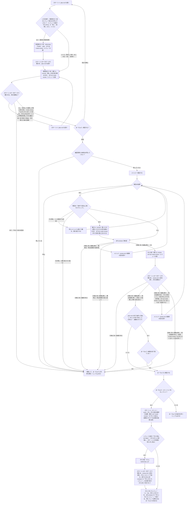

# 作業の流れ

計画から PR までの流れの**正本**。フローチャート・言葉の決まり・回数の上限をここで決める。計画を通さない小さな文書の直し（「簡単な修正の道」）もここで決める。
スキル（plan-writer・delegate-to-mejed・diff-reviewer・codex）と、エージェント（プラグイン ai-team の `agents/`）の文章は、この分かれ目に合わせて書いている。食い違ったら、ここに合わせてスキルを直す。
一覧（プラグイン ai-team の中）：`skills/plan-writer/`・`skills/delegate-to-mejed/`・`skills/diff-reviewer/`・`skills/codex/`・`agents/mejed.md`・`agents/adversary.md`。チーム共通の決まりは同じ `docs/team-rules.md`。

## フローチャート

- 「ここで止まる」の先は、まーちゅうの指示で決める（計画の改訂なら P1、修正の追加なら M2 など）。止まったところから勝手に進めない
- 承認をやり直したら、回数は数え直す（承認前の1つ目は数え直さない。1つの計画につき1回のまま）
- 健さん（K1・K2・K3）を呼べなかったとき（ラッパーが止まった・返事が取れなかった）は、「採る指摘が無い」とは扱わず、H（保留）に進む。承認前の `/code-review`（F1・K1）、PR の前の `/code-review`（K3）、K2 の `/code-review` が終わらなかった・結果が取れなかった・`make-patch` が止まったとき（見せる差分が無い終了コード 4 も、呼ばずに保留する）も同じ（F1 でも、1つ目が済んだとは扱わない）。K1・K2・K3 で健さんを呼べなかったら、待つか `/code-review` に切り替えるかを聞く（言葉の決まりの「レビューの道」）。PR の後の Fさん（FA）が途中で終わった・必読のファイルや差分が読めなかったと報告した・報告の形式に合わないとき、呼ぶ前の秘密情報の照らしで当たった・確かめられなかったときも、「指摘なし」とは扱わず、保留する（FA は呼ばない、または呼んだ結果を採らない。PR はそのまま残す）
- 健さんと `/code-review` の指摘で採ったものは、健さんの付けた重要度にかかわらず、review.md（承認前は plan.md の「承認前の確認」）に**必須**として書く。採らないものは見送りとして理由を書く（メジェドが推奨として見送れないようにするため）
- M3（PR の前のレビュー役の指摘を直した後）は、S1・R1・D1 を通って K3 に戻る。diff-reviewer のレビューを挟むのは、直したところを計画と照らすため。このとき D1 が出す要修正は、diff-reviewer の修正依頼（最大3回）として数える。PR の前の `/code-review` で止めどき（言葉の決まりの「レビューの道」）に当たった回（その回の採る指摘が表記だけ）は、M3 で直させ、S1・R1・D1 を通った後は K3 を呼ばずに IMG へ進む。D1 で要修正が出たら今までどおり M2 で直させるが、その後の D1 の OK でも K3 は呼ばずに IMG へ進む（止めどきに当たった後は、その PR の前の確認で K3 をもう呼ばない。直したところは diff-reviewer が見る）
- 承認前の2つ目（健さんか `/code-review`）と PR の前のレビュー役（健さんか `/code-review`）の上限（それぞれ5回）は、**そのレビュー役を呼んだ回数**で数える（指摘の数や修正依頼の数ではない。切り替えたら、切り替えた後のレビュー役を数え直す）
- K3（健さんの review）には、頼みの文を渡せないので、未コミットの `docs/tasks/<タスク名>/review.md`（ガネーシャの判定と採否）も差分として渡る。K1・K2（consult）では「承認前の確認」の節や review.md を判断に使わないよう頼めるが、K3 では頼めない。健さんの review は実装の差分を見る組み込みのレビューで、採否の先入観の影響は小さいと見て、限界として承知する。承認前の `/code-review`（F1・K1）も頼みの文を渡せず、「承認前の確認」の節も読んだうえで見る。限界として承知する。PR の前と K2 の `/code-review` はパッチに `docs/tasks/<タスク名>/` を入れないので、review.md は渡らない
- 画像のタスク（下の言葉の決まり）では、K3 の後に IMG で「はい」に進み、まーちゅうが画像を目で見る。目視の段（EYE）は次のとおり
  - K3 の返事のうち、`### 人の目で見ること` に当たること（画風など）は、採否を決めない（EYE で決める）。`### AI が見ること` に当たること（大きさ・透過など）は、ほかの指摘と同じく一次データで確かめて採否を決める
  - ガネーシャは、画像のファイルをまーちゅうが開ける形で渡し（plan-writer の手順7の渡し方と同じ）、「人の目で見ること」の項目を添えて、OK か NG かを聞く
  - 答えは review.md に回として書く（出所 `まーちゅう・目視`。まーちゅうの言葉をそのまま引用）。NG の項目は、その回の「指摘」の表に**必須**として書く（問題と理由に、まーちゅうの言葉をそのまま引用する。メジェドが「必須」から直すため）
  - NG なら保留する。作り直すか、計画を直すかは、まーちゅうの指示で決める（決まった形の修正のループは回さない）
  - 作り直しを頼まれたら、メジェドに目視の回の必須を直させ（M2 と同じ頼み方）、S1・R1・D1・K3 を通って EYE に戻る。上限に数えないのは、この作り直しの依頼1回だけ（diff-reviewer の指摘による修正依頼の数に足さない）。戻り道の D1 の要修正と K3 は、ふつうに数える。PR の前のレビュー役をすでに5回呼んでいたら、戻り道の K3 は呼ばずに保留する。review.md の目視の回の「数」は、承認依頼の番号だけのまま。計画を直すなら P1 に戻る
  - PR に付いたレビュー（PR の後の Fさん・人・bot）で画像の作り直しが要る指摘が来たら、保留する（目視の NG と同じ。作り直させる決まった道は作らない）

## 言葉の決まり

- **計画に効く指摘**：plan.md を変えないと直らない指摘。どこで出ても保留する（diff-reviewer の「計画への指摘」も同じ）
- **2回以上落ちたチェック**：common-rules.md の「チェックコマンド」の箇条1つ、または plan.md の `### AI が見ること` の項目1つが、1回の実装・修正の作業の中で2回以上失敗したもの
- **停止**：メジェドが着手しない・続けられないと報告すること（未承認・確認事項が残っている・計画どおりに実装できない・計画どおりでは直せない・弱めないと通せない・workflow.md が読めない・コマンドが確認で止められた／拒否された）。報告の「結果」に「停止」と書く。コマンドが止められたときの理由には、止まったコマンドと、ask か deny かを書く（チーム共通の決まり（team-rules.md）の「作業の進め方」）
- **保留**：ガネーシャが止まって、まーちゅうに判断を頼むこと。理由（メジェドの停止の理由・達した上限・該当する指摘）を添える
- **確認事項の未解決**：plan.md の「確認事項」を、**最上位の箇条ごと**に判定する。ガネーシャの Q1 とメジェドの手順2は、同じこの基準で判定する
  - 本文がちょうど「なし」だけの項目は、解決扱い（質問ではない。注記は子の箇条に書く）
  - それ以外の項目は、**「→」で始まり「（YYYY-MM-DD まーちゅう）」の署名で終わる答えの行**（同じ行でも子の箇条でもよい）があれば解決。署名の無い「→」（ガネーシャの案など）は未解決
  - 「→ 後で決める」で始まる答えは、署名があっても未解決
  - まーちゅうの答えを、ガネーシャが「→」に続けて書き足してよい。答えが本文を変えないもの（「OK」「その方針で」など）なら、確認事項は本文に入らないので改訂には当たらない（承認欄は外さない）
  - 答えが本文の変更を要するもの（例: 「A か B か」に「B で」と答えた）なら、本文を直す改訂として扱い、承認をやり直す（P1 に戻る）。メジェドは本文どおりに作るので、本文を直さないと答えが実装されないため
  - ガネーシャ自身の案や見立てを「→」で書かない（まーちゅうが答えていないのに解決に見えるため）
- **承認欄**：plan.md の冒頭の「承認」の行。次のとおり扱う（ここが正本。スキル・テンプレート・README は、ここを指すだけにする）
  - 承認欄は、まーちゅうが会話で承認したとき（「承認する」「OK、進めて」など、計画を指して承認する言葉）に、ガネーシャが埋める。`[x]`・承認日・承認の言葉（そのまま引用）を書く
  - ガネーシャは、自分の判断では埋めない。まーちゅうの言葉が承認か分からないときは、埋める前に聞く
  - 承認と一緒に確かめたことは、**本文にもう書いてあることの確認だけ**を承認の言葉のあとに添える（例：本文に「settings.json はガネーシャが入れる」とあり、承認のときにそれも OK と言われた）。本文を変える中身（本文と違う担当・対象など）なら、承認欄に添えずに本文を直す改訂として扱い、承認をやり直す（承認欄は本文に入らないので、添えるだけでは実装に届かないため）
  - 改訂して承認をやり直すときは、ガネーシャがチェックを外し、まーちゅうの次の承認の言葉で、また埋める
  - メジェドと diff-reviewer は、承認欄にチェックがあるかを見るだけ（誰が埋めたかは見ない）
- **レビューの道**：タスクごとに選ぶ、承認前（計画書）・PR の前（差分）・PR の後（PR の差分）のレビュー役の組み合わせ。plan.md の冒頭の箇条「レビューの道」に書く（承認前にレビューが1つも無い道は選べない）
  - 承認前の1つ目（最初の承認依頼の前に1回）：`Fable`（`ai-team:adversary`。今まで）か `/code-review`（計画書に1回）
  - 承認前の2つ目（採る指摘が0になるまで、承認依頼ごとに最大5回）：`健さん`（`consult`。今まで）か `/code-review`（計画書に）
  - 1つ目と2つ目を両方 `/code-review` にするときは、「別々」（1つ目の1回の後に、2つ目を最大5回）か「まとめる」（2つ目の最大5回だけ。1回目を1つ目の代わりとも数える）を選ぶ
  - 承認前の1つ目を省けるのは、README の「テンプレートを直した後の反映」の流れだけ（1つ目に「省く（反映）」と書く。2つ目は省けない）
  - PR の前（`K3`。採る指摘が0になるまで、最大5回）：`健さん`（`review`。今まで）か `/code-review`（差分に）
  - PR の後（`FA`。1つの PR につき1回）：`Fable`（Fさん。`ai-team:adversary` のタイミング `pr`）か `なし`。欄に PR の後の段が無い plan.md（この決まりより前のもの）は `なし` として扱う。簡単な修正の道には、この段は無い（Fさんは回さない。adversary の `pr` は plan.md の目的・完了条件と照らすので、plan.md が無いと読めない）
    - いつ回すか：delegate-to-mejed の手順8で PR を作った直後に、まーちゅうの合図を待たずにバックグラウンドで回し、PR のリンクと一緒に「Fさんが見ている」と伝える。Fさんの結果を確かめて報告してから止まる。直した後にもう一度回すかは、まーちゅうが決める（上限の外）
    - 呼ぶ前：ガネーシャが差分のパスを秘密情報と照らす。`git diff --name-only --no-renames --ignore-submodules=none -z origin/<既定ブランチ>...<ブランチ>` の一覧（UTF-8・NUL 区切り。`-z` のときパスは引用符で囲まれずにそのまま出る。`git -c`・`git -C` は settings.json の ask に当たるので使わない）を、Bash のリダイレクト（`git diff … -z > <scratchpad のファイル>`）で scratchpad のファイルにそのまま書き（Write ツールは NUL を書けないため）、共有モジュールの入口 `node <プラグインの hooks/ai-team-config.mjs> check --root <作業ツリー> --root <メインのチェックアウト> --paths-file <一覧> --out <結果> --resolve-real` で照らす（健さんのラッパーと同じ照らし方。この `node` のコマンドは settings.json の allow に無いので、確認が出ることがある）。当たった・確かめられなかったときは、Fさんを呼ばずに保留する。`git fetch origin` も、ガネーシャが呼ぶ前に打つ
    - 結果の扱い：指摘を1件ずつ一次データで確かめ、review.md に「第N回（PR の後・Fさん）」として書き（採ったものは**必須**。見送りは理由つき）、Fさんの報告をそのまま PR にコメントで貼る（秘密情報・クライアント識別情報・ローカルの絶対パスが無いか確かめ、パスだけ相対に直す）。直すものは diff-reviewer の「PR に付いたレビュー」の手順で直す（コードはメジェド、`.md` はまーちゅうの承認でガネーシャ。どちらもコミットして PR のブランチに push）
    - 直した後に、PR の前のレビュー役（K3）はもう一度回さない。その代わり、直したら（コードはメジェド・`.md` はガネーシャ）チェックコマンドを全部打ち、diff-reviewer の「再レビューのとき」の形で直したところを確かめて、review.md に回を書く
    - 採る指摘が無くても、review.md の回（と、直したときはその回）を、まーちゅうの OK を取ってからコミットして PR のブランチに push する（次のタスクで、未コミットの変更が残らないようにするため。PR を作るときの OK は、PR の後のコミットを含まない）
    - 選び方：plan-writer の手順1で、ほかの段と一緒に聞く。おすすめ：手順を書く PR（README の導入・外し方など）・設計の判断が入るもの・ほかのリポジトリ（gh-* など）との約束に効くもの・全リポジトリに効くプラグインの中身の大きい直しは `Fable`、小さい直しは `なし`
  - チェックが2回以上落ちたとき（`K2`）は、PR の前の道に合わせる（健さんなら `consult` で「直ったのか隠しただけか」、`/code-review` なら差分に1回。メジェドの完了の報告ごと。独自の上限は持たない）
  - 書き方の例：`承認前は Fable・健さん ／ PR の前は 健さん ／ PR の後は Fable`、`承認前は Fable・健さん ／ PR の前は 健さん`（PR の後の段が無い今までの道。`なし` と同じ）、`承認前は Fable・/code-review（medium） ／ PR の前は /code-review（high）`、`承認前は /code-review（medium）・健さん ／ PR の前は 健さん`、`承認前は /code-review（medium）・/code-review（medium）（別々） ／ PR の前は /code-review（high）`、`承認前は /code-review（medium）（まとめる） ／ PR の前は 健さん`、`承認前は 省く（反映）・健さん ／ PR の前は 健さん`（反映の流れだけ）。両方 `/code-review` のときは、「別々」か「まとめる」を必ず書く
  - 欄が無い plan.md（この決まりより前に書いたもの）は、今までの道とする（PR の後は `なし`）。欄に PR の前が無いとき（このタスクより前の plan.md）は、PR の前は健さん
  - `/code-review` のレベル：`/code-review` を選んだ段ごとに、レベル（`low`・`medium`・`high`・`xhigh`・`max` のどれか）を `/code-review（medium）` のように書く。ガネーシャは決め打ちせず、選び方のときに、おすすめ（承認前は `medium`、PR の前と K2 は `high`）を添えて聞く。レベルが書いていない `/code-review`（このタスクより前の plan.md）は、承認前は `high`（#43 のときの値）、PR の前と K2 は `high` とする。K2 は PR の前と同じレベル
  - 選び方：plan-writer の手順1で、ガネーシャがおすすめ（今までの道か、理由つきで別の道）を添えて、まーちゅうに聞く。承認前・PR の前・PR の後のすべてを聞く。聞かなかったら今までの道（PR の後は `なし`）。道を変えても本文は変わらないので、承認はやり直さない
  - 健さんが承認前の2つ目・PR の前（K3）・K2 で呼べなかったとき：今までどおり保留し、「待つ？`/code-review` に切り替える？」と聞く。切り替えたら、ガネーシャが「レビューの道」の呼べなかった段を `/code-review`（レベルつき）に書き換え（承認前の2つ目で1つ目が `/code-review` なら「別々」を書く。1つ目はもう済んでいるため）、改訂履歴に書く（承認はやり直さない）。それまでに健さんを呼んだ回数は、`/code-review` の上限に数えない（切り替えた後の `/code-review` を1回目から数える）。切り替えるのは、呼べなかった段だけ。K2 で呼べなかったときは、K2 は PR の前の道に合わせるので、切り替えると PR の前も切り替わることを添えて聞く
  - `/code-review` の呼び方（承認前）：Skill ツールで `code-review` を呼び、引数に `<レベル> --max-findings default <plan.md の絶対パス>` を渡す（`<レベル>` はレビューの道で選んだもの）。渡すのは plan.md 1つだけ。レベルと件数を毎回付けるのは、付けないとどちらも前回の値を使い回し、回ごとに深さと件数が変わって記録にも残らないため
  - `/code-review` の呼び方（PR の前と K2）：ラッパーの `make-patch` でパッチを scratchpad に作り（`invoke-codex.ps1 -Mode make-patch -Task <タスク名> -OutFile <scratchpad のファイル>`。呼び方は `codex` スキル（Skill ツールで `ai-team:codex` を読み込むと、ラッパーの場所が入る）。終了コード 4 なら見せる差分が無いので、呼ばずに保留する）、Skill ツールで `code-review` を呼び、引数に `<レベル> --max-findings default <パッチの絶対パス>` を渡す。パスのファイルの一覧を渡さない（消した行が見えず、秘密情報も渡るため）
  - `/code-review` の限界（承知して使う）
    - 頼みの文を渡せない。plan.md の「承認前の確認」の節（ガネーシャの採否）も読んだうえで見る
    - 指摘を多めに出すように作られていて、採る指摘が0になりにくい（実際に、ある計画で 10 → 10 → 10 → 8 → 9 件と減らなかった）。ガネーシャのおすすめは、健さんが呼べるなら2つ目は健さん
    - 最後に付けたレベルと件数を覚え、まーちゅうが引数なしで `/code-review` を呼んだときにも使う。ガネーシャは `/code-review` を呼んだら、まーちゅうへの報告に「`/code-review` の既定が <呼んだレベル>・default に変わったかもしれない（サブエージェントで呼んだときは確かめていない）」と添える
    - PR の前と K2 では、パッチのファイル名を手がかりに、まわりのファイルをセッションの cwd（メインのチェックアウト）から読むことがあり、worktree の変更より前の中身を読みうる。指摘は worktree の現物で確かめる
  - `/code-review` の止めどき（承認前の2つ目と PR の前のとき）：その回の採る指摘が表記だけ（言い回し・書き写しの細部）なら、直してそこで止める（もう1回は回さない）。事実・判断・決まりの食い違いに効く指摘が1件でもあれば、直してもう1回回す。上限（5回）は変えない。1つ目と K2（どちらも1回だけ）には止めどきは要らない
  - `/code-review` の結果の保存：Skill ツールが返した結果の文（JSON の指摘の一覧と、その前後の文）をそのまま、頭に呼んだ日付・引数・対象の1行を足して、セッションの scratchpad のファイルに書き、健さんのラッパーの保存だけのモードで保存する（`invoke-codex.ps1 -Mode save-code-review -Task <タスク名> -Stage <段> -InputFile <そのファイル>`。`<段>` は承認前が `plan`、PR の前が `pr`、K2 が `check`。呼び方は `codex` スキル（Skill ツールで `ai-team:codex` を読み込むと、ラッパーの場所が入る））。保存先はラッパーが決める（メインのチェックアウトの `docs/tasks/<タスク名>/code-review/<連番>-<段>.md`。Git に無視されていなければ `<一時ディレクトリ>/code-review-replies/<リポジトリのフォルダ名>-<8文字>/<タスク名>/`）。ラッパーが出す `SAVED:` の行の保存先を、承認前は plan.md の「承認前の確認」の「返事：」に、PR の前と K2 は review.md のその回の「返事：」に書く（簡単な修正の道では PR 本文に書く）。保存先が一時ディレクトリ（絶対パス）なら、OS の一時ディレクトリの部分を `<一時ディレクトリ>` と書く（例：`<一時ディレクトリ>/code-review-replies/<リポジトリのフォルダ名>-<8文字>/<タスク名>/01-pr.md`。plan.md・review.md・PR 本文にローカルの絶対パスやユーザー名を残さないため）。頭に足す1行の引数と対象は、絶対パスを書かず、リポジトリの根からの相対パス（plan.md）か `<パッチ>`（`make-patch` で作ったパッチ。scratchpad の場所は書かない）で書く（結果を PR に貼るとき、ローカルの絶対パスやユーザー名が出ないため）。要約や書き換えはしない
  - `/code-review` が終わらなかった・結果が取れなかった・保存できなかった・`make-patch` が止まったときは、「指摘なし」とは扱わず保留する（1つ目でも、済んだとは扱わない）
- **バックグラウンド**：時間のかかる役とチェックは、バックグラウンドで回し、待つ間に止まらない
  - メジェド・Fさんは Agent ツールの `run_in_background`、健さんはラッパーを Bash ツールの `run_in_background`、純ちゃんは「`/code-review` を呼んで結果をそのまま返す」頼みのサブエージェント（general-purpose）を Agent ツールの `run_in_background` で回す
  - メジェドを呼ぶときの例外：plan.md の「対象ファイル」に `.claude/`・`docs/team/`・リポジトリの根の `CLAUDE.md`（ガードが、メジェドでも確認（ask）を返す場所。`hooks/guard-code-edit.mjs`）が入っているタスクは、メジェドを最初からフォアグラウンドで呼ぶ（バックグラウンドのサブエージェントは途中で確認を受けられず、止まるため）
  - バックグラウンドで呼んだメジェドが、確認（ask）を受けられずに止まって停止したら、フォアグラウンドで同じ頼みをやり直す。この停止は、回数の上限には数えない。deny（settings.json の deny）や、まーちゅうがダイアログで拒否したことで止まったときは、やり直さずに保留する（フォアグラウンドにしても通らない・通すべきでないため。どちらかは、停止の報告の「ask か deny か」（チーム共通の決まり）で見分ける）
  - バックグラウンドで呼んだ Fさんが、確認（ask）を受けられずに作業ディレクトリの外のファイルや差分が読めなかったと返したら（リポジトリの外の worktree・外との約束の相手側を読むときに起こりうる）、フォアグラウンドで同じ頼みをやり直す。上限には数えない。deny やまーちゅうの拒否で読めなかったときは、やり直さずに保留する
  - 時間のかかるチェックコマンド（テスト・`claude plugin validate`・各リポジトリのチェックコマンドのうち時間のかかるもの）も Bash ツールの `run_in_background` で打つ。すぐ終わる確かめ（`git status`・grep など）はそのまま打つ
  - 回したら、終わりの知らせを受けてから結果を読む。知らせが来る前に結果を推測して進めない
  - 待つ間にまーちゅうに頼まれたことは、回している役と同じファイルを触らない範囲で受ける
  - 純ちゃんのサブエージェントへの頼みの文：Skill ツールで `code-review` を、ガネーシャが決めた引数（レベル・`--max-findings default`・対象）そのままで呼び、返った結果の文を書き換えずに返す。ファイルを書き換えない・git を打たない。結果の保存（`save-code-review`）は今までどおりガネーシャがする
  - 純ちゃんをサブエージェントの中で呼んだとき、まーちゅうが引数なしで呼んだときの既定が変わるかは確かめていない
- **本文**：plan.md のうち、冒頭の箇条（作成・承認・ブランチ・イシュー・worktree・メジェドのモデル・レビューの道・改訂履歴）と、「承認前の確認」「確認事項」の節を除いた部分。承認をやり直す改訂は、本文が変わったときだけ
- **画像のタスク**：健さんの `image` で作った画像を差分に入れるタスク。plan.md の「完了条件」の節に、行頭の見出し `### 人の目で見ること` があるかで見分ける（文字列が本文やコメントに出てくるだけでは当たらない）。画像のタスクでは、K3 の後に、まーちゅうが画像を目で見る（目視の段）

## 回数の上限

| 上限 | 数え方 | 超えたら |
| --- | --- | --- |
| 承認前の1つ目（Fable か /code-review） | 1つの計画につき1回（最初の承認依頼の前）。両方 /code-review で「まとめる」なら、2つ目の1回目で兼ねる。反映の流れで「省く（反映）」なら呼ばない | — |
| 承認前の2つ目（健さんか /code-review） | 承認を頼むたびに、呼んだ回数で最大5回。採る指摘が0になったら止める（見送った指摘しか無い回も止める。`/code-review` は止めどき（言葉の決まり）でも止める） | 5回目でも採る指摘があれば保留（`/code-review` で止めどきに当たった回は、表記を直して承認依頼へ） |
| メジェドの報告の書き直し | 報告ごとに1回だけ。同じメジェドに続けて頼む（新しく呼ぶと前の経過を知らないため） | 保留 |
| diff-reviewer の指摘による修正依頼 | 最大3回（PR の前のレビュー役の指摘を直した後の D1 の要修正も、ここで数える） | 保留 |
| PR の前（健さんか /code-review） | レビュー役を呼んだ回数で最大5回。採る指摘が0になったら止める（見送った指摘しか無い回も止める。`/code-review` は止めどき（言葉の決まり）でも止める） | 5回目でも採る指摘があれば保留（`/code-review` で止めどきに当たった回は、表記を直して報告へ） |
| チェックが2回以上落ちたとき（健さんか /code-review。PR の前の道に合わせる） | メジェドの完了の報告ごと。独自の上限は持たない | 修正の上限で止まる |
| PR の後（Fさん） | 1つの PR につき1回（レビューの道で `Fable` のとき） | — |
| PR に付いたレビュー（PR の後の Fさん・人・bot）による直し | 最大3回 | 保留 |

- まーちゅうに頼まれて回す分（「もう1回健さんに」など）は上限の外
- 数えた値は、承認前の分は plan.md の「承認前の確認」に、実装の後の分は review.md の回の「数」に書く（どちらも承認依頼の番号を書く）。セッションをまたいでも数え直せるようにするため
- PR に付いたレビュー（PR の後の Fさんを含む）の直しは、メジェドに直させた回数と、ガネーシャが `.md` を直した回数を合わせて数える（review.md の第N回の N では数えない）
- bot のレビュー（Copilot など）が付く設定のリポジトリでも、再レビューを頼むかはまーちゅうが決める。bot のレビューが来なくても待たない
- `/code-review` は、レビューの道で選んだときと、まーちゅうに頼まれたときに回す
- 報告の「2回以上落ちたチェック：なし」はメジェドの自己申告で、真偽を確かめる手段は無い。弱めたテストは diff-reviewer の差分のレビューと、PR の前のレビュー役（健さんか `/code-review`）の確認で見る

## 簡単な修正の道

計画（plan.md）・メジェド・diff-reviewer を通さず、小さな文書の直しをガネーシャが直して、PR の前のレビュー役（健さんの review か `/code-review`）だけを通して PR にする道。まーちゅうの OK があったときだけ入る。フローチャートには入れず、ここの箇条で決める。

- **範囲**：決まりを持たない説明の文書（README など）の `.md` の小さな直し。誤字・言い回し・リンクの直し、手順の説明や注意書きの追記など
  - **入れないもの**（置き場所にかかわらず、役割で外す）：規約と作業の流れ（`docs/team/`、プラグイン ai-team の `docs/`。テンプレートのリポジトリでは `repo-files/docs/team/`・`plugins/ai-team/docs/`）、根の `CLAUDE.md`、スキル・エージェント・フック・settings.json（`.claude/`、プラグイン ai-team の中身。テンプレートのリポジトリでは `plugins/ai-team/`・`repo-files/claude/`）、健さんの決まり（AGENTS.md）、コード、`docs/tasks/` の下の記録
- **入り方**：ガネーシャが「簡単な修正の道で進めていい？」と、直すファイルとブランチ名を添えてまーちゅうに聞き、まーちゅうが OK と言ったときだけ。まーちゅうから「計画なしで」「健さんだけで」と頼まれたときも入ってよい。PR の前のレビュー役も一緒に聞く（おすすめを添える。聞かなかったら健さん）。範囲に入るか迷ったら、ふつうの流れにするか、まーちゅうに聞く
- **流れ**
  0. 作業ツリーを確かめる。`git status --short --branch` で未コミット・未追跡の変更が無いこと（PR の前のレビュー役に全部渡るため）を確かめ、あれば止まって報告する。`git fetch origin` のあと、ブランチを切る（gh-issue などで worktree が用意されていればそれを使い、切らない）。ブランチの切り方は delegate-to-mejed の手順2と同じ。まーちゅうの OK には、このブランチを切ることが含まれる
  1. ガネーシャが直す。plan.md・review.md は作らない。直したら（手順3で直したときも）、common-rules.md の「チェックコマンド」を全部実行し、通ることを確かめる。通らなければ、範囲の外の変更が要るかを見て、要るなら手順4と同じく保留する
  2. PR の前のレビュー役を頼む。`/code-review` のときは、ラッパーの `make-patch` でパッチを作って渡し、結果を `save-code-review -Stage pr` で保存する（呼び方は言葉の決まりの「レビューの道」）。`-Task` には、直す中身を表すタスク名（英小文字のケバブケース）を付ける。タスク名は、返事の保存先の2か所（メインのチェックアウト（`git worktree list` の1件目）の `docs/tasks/<タスク名>/codex/`、と `<一時ディレクトリ>/codex-replies/<リポジトリのフォルダ名>-<8文字>/<タスク名>/。codex スキルの「ラッパーがしてくれること」。`/code-review` のときは、これに加えて `code-review/` と `<一時ディレクトリ>/code-review-replies/…`）の**どちらにも**まだ無い名前にする（ラッパーは worktree から呼んでも返事をメインのチェックアウトの下に残し、保存先が Git に無視されないときは一時ディレクトリに残すため）
  3. PR の前のレビュー役の返事を1件ずつ一次データで確かめる。採る指摘は、範囲の中ならガネーシャが直して、もう一度 PR の前のレビュー役に頼む。上限は「PR の前（健さんか /code-review）」と同じ（レビュー役を呼んだ回数で最大5回。採る指摘が0になったら止める）。回数は、返事の保存先の2か所（手順2）の review の返事のファイル（`/code-review` なら `code-review` の返事のファイル）の数を**足して**数える（`.gitignore` の書き方によっては、返事ごとに保存先が分かれることがあるため。`SAVED:` の行に出た保存先の1か所だけを数えない）。まーちゅうに頼まれて回した回（上限の外）は、そのファイル名をまーちゅうへの報告と PR 本文に書き、数から引く。5回目でも採る指摘があれば保留する。ただし `/code-review` で、その回の採る指摘が表記だけなら（止めどき。5回目でも）、直して頼み直さずに手順6へ進む
  4. 採る指摘が、範囲の外のファイルや決まりの変更を要するなら、この道をやめて保留する。直しは作業ツリーに残したまま、まーちゅうに、ふつうの流れに移るか・直しを捨てるかを聞く。ふつうの流れに移るなら、plan-writer で plan.md を書き、残した直しを「対象ファイル」と「背景・前提」に書く
  5. PR の前のレビュー役を呼べなかったとき（`make-patch` が止まったときを含む）は、「指摘なし」とは扱わず、保留する
  6. まーちゅうに報告する（変更したファイル・チェックコマンドの結果・選んだ PR の前のレビュー役・その返事の保存先・回ごとの採った指摘と見送った指摘と理由・呼んだ回数）。「コミットと PR をしていい？」と聞き、頼まれたらコミット・push・PR を作る（やり方は delegate-to-mejed の手順8と同じ。plan.md・review.md のリンクの代わりに、簡単な修正の道で通したこと、チェックコマンドの結果、選んだ PR の前のレビュー役、その回ごとの採った指摘・見送った指摘と理由・呼んだ回数（上限の外の回はその旨）を本文に書く）
  7. PR の前のレビュー役の返事（健さんか `/code-review`）を、全部の回の分、PR に貼る（貼る前の確かめは delegate-to-mejed の手順8と同じ）。`SAVED:` の保存先を本文に書くときは、一時ディレクトリなら `<一時ディレクトリ>` と書く
- **PR に付いたレビュー（人・bot）**：diff-reviewer は使わない（plan.md が無いため）。ガネーシャが指摘を1件ずつ一次データで確かめ、直す指摘と直し方をまーちゅうに伝えて承認を得てから、範囲の中なら直し、チェックコマンドを全部実行して通ることを確かめてから、追加コミット・push し、スレッドに返信する（PR を作るときの OK は、PR の後の直しを含まない）。記録は、スレッドの返信と PR のコミットに残す（review.md は作らない）。修正の上限は「PR に付いたレビューによる直し」と同じ最大3回で、PR に積んだ直しのコミットの数で数える。範囲の外を要する指摘は、手順4と同じく保留する
- PR の前のレビュー役は省かない
- PR の後の Fさんは回さない（レビューの道の「PR の後」は plan.md が要る）
