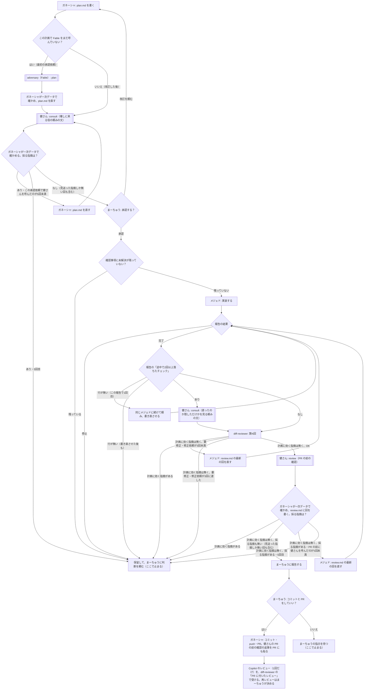

# 作業の流れ

計画から PR までの流れの**正本**。フローチャート・言葉の決まり・回数の上限をここで決める。
スキル（plan-writer・delegate-to-mejed・diff-reviewer・codex）と `.claude/agents/` の文章は、この分かれ目に合わせて書いている。食い違ったら、ここに合わせてスキルを直す。
一覧：`.claude/skills/plan-writer/`・`.claude/skills/delegate-to-mejed/`・`.claude/skills/diff-reviewer/`・`.claude/skills/codex/`・`.claude/agents/mejed.md`・`.claude/agents/adversary.md`。

## フローチャート

- 「ここで止まる」の先は、まーちゅうの指示で決める（計画の改訂なら P1、修正の追加なら M2 など）。止まったところから勝手に進めない
- 承認をやり直したら、回数は数え直す（Fable は数え直さない。1つの計画につき1回のまま）
- 健さん（K1・K2・K3）を呼べなかったとき（ラッパーが止まった・返事が取れなかった）は、「採る指摘が無い」とは扱わず、H（保留）に進む
- 健さんの指摘で採ったものは、健さんの付けた重要度にかかわらず、review.md（承認前は plan.md の「承認前の確認」）に**必須**として書く。採らないものは見送りとして理由を書く（メジェドが推奨として見送れないようにするため）
- M3（健さんの指摘を直した後）は、S1・R1・D1 を通って K3 に戻る。diff-reviewer のレビューを挟むのは、直したところを計画と照らすため。このとき D1 が出す要修正は、diff-reviewer の修正依頼（最大3回）として数える
- 健さんの上限（承認前・PR の前それぞれ5回）は、**健さんを呼んだ回数**で数える（指摘の数や修正依頼の数ではない）
- K3（健さんの review）には、頼みの文を渡せないので、未コミットの `docs/tasks/<タスク名>/review.md`（ガネーシャの判定と採否）も差分として渡る。K1・K2（consult）では「承認前の確認」の節や review.md を判断に使わないよう頼めるが、K3 では頼めない。健さんの review は実装の差分を見る組み込みのレビューで、採否の先入観の影響は小さいと見て、限界として承知する

## 言葉の決まり

- **計画に効く指摘**：plan.md を変えないと直らない指摘。どこで出ても保留する（diff-reviewer の「計画への指摘」も同じ）
- **2回以上落ちたチェック**：common-rules.md の「チェックコマンド」の箇条1つが、1回の実装・修正の作業の中で2回以上失敗したもの
- **停止**：メジェドが着手しない・続けられないと報告すること（未承認・確認事項が残っている・計画どおりに実装できない・計画どおりでは直せない・弱めないと通せない・workflow.md が読めない）。報告の「結果」に「停止」と書く
- **保留**：ガネーシャが止まって、まーちゅうに判断を頼むこと。理由（メジェドの停止の理由・達した上限・該当する指摘）を添える
- **確認事項の未解決**：plan.md の「確認事項」を、**最上位の箇条ごと**に判定する。ガネーシャの Q1 とメジェドの手順2は、同じこの基準で判定する
  - 本文がちょうど「なし」だけの項目は、解決扱い（質問ではない。注記は子の箇条に書く）
  - それ以外の項目は、**「→」で始まり「（YYYY-MM-DD まーちゅう）」の署名で終わる答えの行**（同じ行でも子の箇条でもよい）があれば解決。署名の無い「→」（ガネーシャの案など）は未解決
  - 「→ 後で決める」で始まる答えは、署名があっても未解決
  - まーちゅうの答えを、ガネーシャが「→」に続けて書き足してよい。答えが本文を変えないもの（「OK」「その方針で」など）なら、確認事項は本文に入らないので改訂には当たらない（承認欄は外さない）
  - 答えが本文の変更を要するもの（例: 「A か B か」に「B で」と答えた）なら、本文を直す改訂として扱い、承認をやり直す（P1 に戻る）。メジェドは本文どおりに作るので、本文を直さないと答えが実装されないため
  - ガネーシャ自身の案や見立てを「→」で書かない（まーちゅうが答えていないのに解決に見えるため）
- **承認欄**：plan.md の冒頭の「承認」の行。次のとおり扱う（ここが正本。スキル・テンプレート・README は、ここを指すだけにする）
  - 承認欄は、まーちゅうが会話で承認したとき（「承認する」「OK、進めて」など、計画を指して承認する言葉）に、ガネーシャが埋める。`[x]`・承認日・承認の言葉（そのまま引用）を書く
  - ガネーシャは、自分の判断では埋めない。まーちゅうの言葉が承認か分からないときは、埋める前に聞く
  - 承認と一緒に確かめたことは、**本文にもう書いてあることの確認だけ**を承認の言葉のあとに添える（例：本文に「settings.json はガネーシャが入れる」とあり、承認のときにそれも OK と言われた）。本文を変える中身（本文と違う担当・対象など）なら、承認欄に添えずに本文を直す改訂として扱い、承認をやり直す（承認欄は本文に入らないので、添えるだけでは実装に届かないため）
  - 改訂して承認をやり直すときは、ガネーシャがチェックを外し、まーちゅうの次の承認の言葉で、また埋める
  - メジェドと diff-reviewer は、承認欄にチェックがあるかを見るだけ（誰が埋めたかは見ない）
- **本文**：plan.md のうち、冒頭の箇条（作成・承認・ブランチ・イシュー・改訂履歴）と、「承認前の確認」「確認事項」の節を除いた部分。承認をやり直す改訂は、本文が変わったときだけ

## 回数の上限

| 上限 | 数え方 | 超えたら |
| --- | --- | --- |
| 承認前の Fable | 1つの計画につき1回（最初の承認依頼の前） | — |
| 承認前の健さん | 承認を頼むたびに、健さんを呼んだ回数で最大5回。採る指摘が0になったら止める（見送った指摘しか無い回も止める） | 5回目でも採る指摘があれば保留 |
| メジェドの報告の書き直し | 報告ごとに1回だけ。同じメジェドに続けて頼む（新しく呼ぶと前の経過を知らないため） | 保留 |
| diff-reviewer の指摘による修正依頼 | 最大3回（健さんの指摘を直した後の D1 の要修正も、ここで数える） | 保留 |
| PR の前の健さん | 健さんを呼んだ回数で最大5回。採る指摘が0になったら止める（見送った指摘しか無い回も止める） | 5回目でも採る指摘があれば保留 |
| チェックが2回以上落ちたときの健さん | メジェドの完了の報告ごと。独自の上限は持たない | 修正の上限で止まる |
| PR に付いたレビュー（Copilot・人）による修正依頼 | 最大3回 | 保留 |

- まーちゅうに頼まれて回す分（「もう1回健さんに」など）は上限の外
- 数えた値は、承認前の分は plan.md の「承認前の確認」に、実装の後の分は review.md の回の「数」に書く（どちらも承認依頼の番号を書く）。セッションをまたいでも数え直せるようにするため
- PR に付いたレビューの修正依頼は、PR レビューでメジェドに直させた回数で数える（review.md の第N回の N では数えない）
- Copilot のレビューは PR で1回だけ。直した後に再レビューを頼むかは、まーちゅうが決める
- `/code-review` は、まーちゅうに頼まれたときだけ回す（流れには入れない）
- 報告の「2回以上落ちたチェック：なし」はメジェドの自己申告で、真偽を確かめる手段は無い。弱めたテストは diff-reviewer の差分のレビューと、健さんの PR の前の確認で見る
