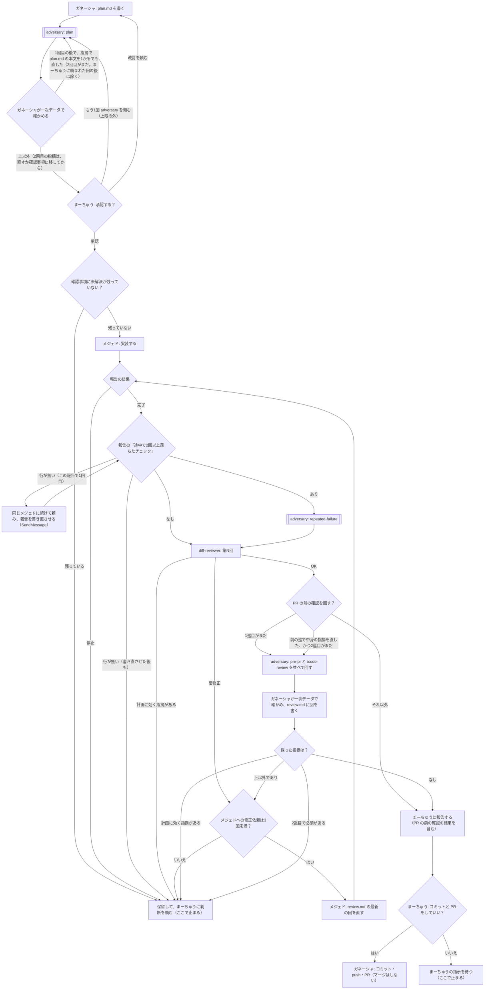

# 作業の流れ

計画から PR までの流れの**正本**。フローチャート・言葉の決まり・回数の上限をここで決める。
スキル（plan-writer・delegate-to-mejed・diff-reviewer）と `.claude/agents/mejed.md` の文章は、この分かれ目に合わせて書いている。食い違ったら、ここに合わせてスキルを直す。

## フローチャート

- 「ここで止まる」の先は、まーちゅうの指示で決める（計画の改訂なら P1、修正の追加なら M2 など）。止まったところから勝手に進めない
- 承認をやり直したら、下の回数の上限はすべて数え直す

## 言葉の決まり

- **計画に効く指摘**：plan.md を変えないと直らない指摘。どこで出ても保留する（diff-reviewer の「計画への指摘」も同じ）
- **中身の指摘**：事実・判断・規則に効く指摘。**表記だけの指摘**（言い回し・引用・リンクの付け方）と分ける
- **2回以上落ちたチェック**：common-rules.md の「チェックコマンド」の箇条1つが、1回の実装・修正の作業の中で2回以上失敗したもの
- **停止**：メジェドが着手しない・続けられないと報告すること（未承認・確認事項が残っている・計画どおりに実装できない・弱めないと通せない）。報告の「結果」に「停止」と書く
- **保留**：ガネーシャが止まって、まーちゅうに判断を頼むこと。理由（メジェドの停止の理由・達した上限・該当する指摘）を添える
- **確認事項の未解決**：plan.md の「確認事項」の項目のうち、まーちゅうの答えが「→」に続けて書き足されていないもの（例: 「→ OK（2026-10-04 まーちゅう）」）。節が「なし」だけなら未解決は無い。ガネーシャの Q1 とメジェドの手順2は、同じこの基準で判定する

## 回数の上限

| 上限 | 数え方 | 超えたら |
| --- | --- | --- |
| 承認前の adversary は、承認を頼むたびに最大2回 | 1回目は書き終えたとき。2回目は、1回目の指摘で plan.md の本文を1か所でも直したときだけ。まーちゅうに頼まれて回す分は上限の外 | 2回目の指摘は、plan.md を直すか確認事項に移して承認を頼む。直したところは承認を頼むときに伝える |
| メジェドの報告の書き直し | 報告ごとに1回だけ。同じメジェドに続けて頼む（新しく呼ぶと前の経過を知らないため） | 保留 |
| メジェドへの修正依頼は最大3回 | 由来を問わず合算（diff-reviewer・repeated-failure・PR の前の確認） | 保留 |
| PR の前の確認は最大2巡 | 1巡 = adversary（pre-pr）と `/code-review high --max-findings default` を1回ずつ。2巡目は、1巡目で中身の指摘を直したときだけ | 2巡目で必須が出たら、直さずに保留 |
| repeated-failure の adversary | メジェドの完了の報告ごと。独自の上限は持たない | 修正依頼の上限で止まる（PR の前までで多くて4回） |
| PR に付いたレビューでの修正依頼は最大3回 | PR レビューでメジェドに直させた回数（review.md の第N回の N では数えない） | 3回直しても必須が残れば保留 |

- 数えた値は review.md の回の「数」に書く。セッションをまたいでも数え直せるようにするため
- 報告の「2回以上落ちたチェック：なし」はメジェドの自己申告で、真偽を確かめる手段は無い。弱めたテストは diff-reviewer の差分のレビューで見る
